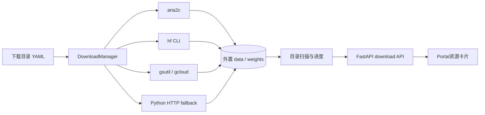

# 数据与模型下载管理设计

版本：v1.0 ｜ 日期：2026年10月12日 ｜ 状态：首版已实现

## 目标与边界

Portal统一展示3个模型权重和7个任务数据资源的本地状态，并允许启动、暂停、续传和校验。所有下载目标都由版本化目录 `configs/downloads/catalog.yaml` 声明；API不接受用户提交的URL或目标路径。数据、权重、下载日志和完成标记位于Git仓库之外。

## 资源目录

每个资源固定以下信息：

- 稳定的 `resource_id`、资源类型和关联任务；
- 官方来源页、许可证、下载方法和版本/revision；
- 外置根目录类型及相对目标目录；
- 文件URL、精确字节数和可获得的SHA-256；
- 用于结构核验的完成路径；
- 容量是否为估算值以及操作说明。

当前目录包含：

| 类型 | 资源 | 下载方式 | 目录容量 |
|---|---|---|---:|
| 模型 | AnySat Base | aria2/HTTPS | 503,756,453 B |
| 模型 | Clay v1.5 | aria2/HTTPS | 5,158,764,629 B |
| 模型 | Prithvi-EO-2.0 300M-TL | aria2/HTTPS | 1,326,707,784 B |
| 数据 | Sen1Floods11 v1.1 | gsutil/gcloud rsync | 约14 GiB |
| 数据 | HLS Burn Scars | aria2/HTTPS | 2,645,552,531 B |
| 数据 | Burn Intensity | aria2/HTTPS | 893,685,824 B |
| 数据 | Landslide4Sense | Hugging Face snapshot | 约8.99 GB |
| 数据 | US Multi-temporal Crops | aria2/HTTPS | 11,780,973,746 B |
| 数据 | Sen4Map train/val/test | aria2/HTTPS | 约1.16 TiB |
| 数据 | BioMassters | Hugging Face snapshot | 约201 GB |

Sen4Map同时服务T6a与T6b，因此7项业务任务对应7个数据资源，而不是8份重复数据。

## 下载执行



普通HTTPS下载优先使用系统 `aria2c`，设置断点续传、禁用预分配，并按目录中的SHA-256执行完整性校验。系统没有aria2时，使用标准库实现的HTTP Range续传。Hugging Face快照固定revision，避免上游更新导致实验输入漂移。GCS资源使用官方同步工具。

下载进程由Portal启动，不经过shell。暂停会向整个进程组发送终止信号，保留局部文件；再次启动会由对应引擎续传。Portal退出时主动暂停其启动的任务，避免留下失去监控的孤儿进程。

## 状态与完成判定

状态包括 `missing`、`partial`、`present`、`downloading`、`verifying`、`paused`、`failed`、`complete` 和 `unavailable`。

- HTTPS资源按目录声明的文件统计精确进度；
- 快照与目录同步按目标目录占用量和估算总量统计；
- 进程成功退出后检查必需路径；精确文件继续检查大小与SHA-256；
- 验证通过后原子写入 `.rs-download-complete.json`；
- Portal重启后根据完成标记和实际文件恢复状态，不依赖内存任务记录；
- 已手工放入的完整文件显示为 `present`，用户可点击“校验”生成完成标记。
- 启动前比较剩余下载量与目标文件系统可用空间；空间不足时禁用下载按钮。

## API

```text
GET  /api/downloads
GET  /api/downloads/{resource_id}
POST /api/downloads/{resource_id}/start
POST /api/downloads/{resource_id}/pause
POST /api/downloads/{resource_id}/verify
```

下载控制默认启用，Portal默认仅监听 `127.0.0.1`。设置 `RS_EVAL_DOWNLOADS_ENABLED=false` 可以保留状态展示并关闭所有写操作。API只能选择已校验目录中的资源ID，目标路径必须保持在 `RS_EVAL_DATA_ROOT` 或 `RS_EVAL_WEIGHTS_ROOT` 内。

## 运行依赖

```bash
uv sync --extra portal --extra downloads

# Debian/Ubuntu，推荐的HTTPS引擎
sudo apt-get install aria2

# Sen1Floods11需要Google Cloud CLI中的gsutil或gcloud
```

公开Hugging Face资源不要求令牌。若后续加入受限资源，可在进程环境提供 `HF_TOKEN`，不得写入目录YAML、`.env.example`或Git历史。

## 后续工作

下载完成只代表原始payload可用。解压、目录规范化、数据切分核验、manifest生成和预处理应作为独立的可重放prepare阶段，并为每个产物记录源文件SHA-256与处理配置哈希。Portal后续可在同一资源卡片展示“已下载 / 已解压 / manifest有效”三层就绪状态。

实施备注（2026-10-12）：Sen1Floods11全量bucket实测约34.3 GiB / 3.1万个文件（弱标签catalog占绝大部分），首轮T1只需要hand-labeled子集（S2Hand 447景 + LabelHand + splits + 事件元数据，约1 GB），已按“手工放入完整文件”通道定点同步，Portal按目录扫描如实显示partial状态。T1 manifest由 `rs-eval build-manifest --task T1` 生成。需要网络代理时，Portal应带 `http_proxy`/`https_proxy` 环境变量启动（见 `.env.example`），aria2c/gsutil/hf子进程会继承。
