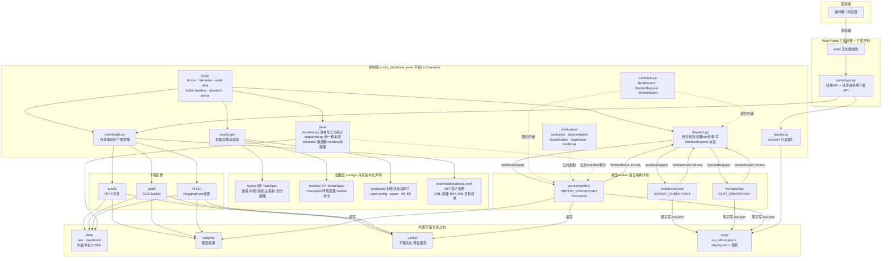
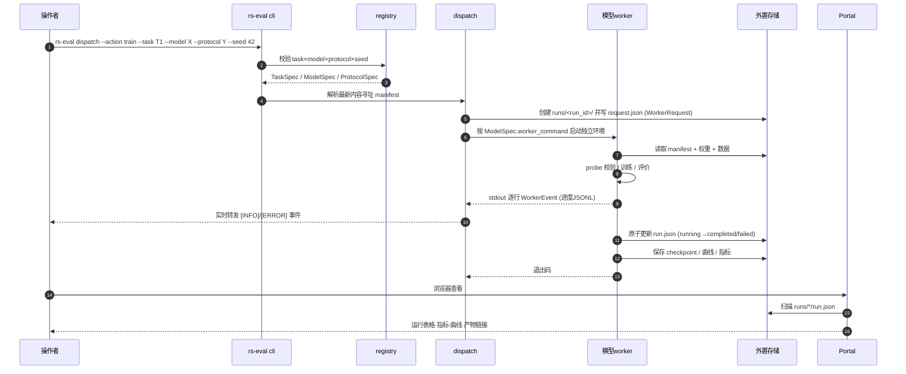
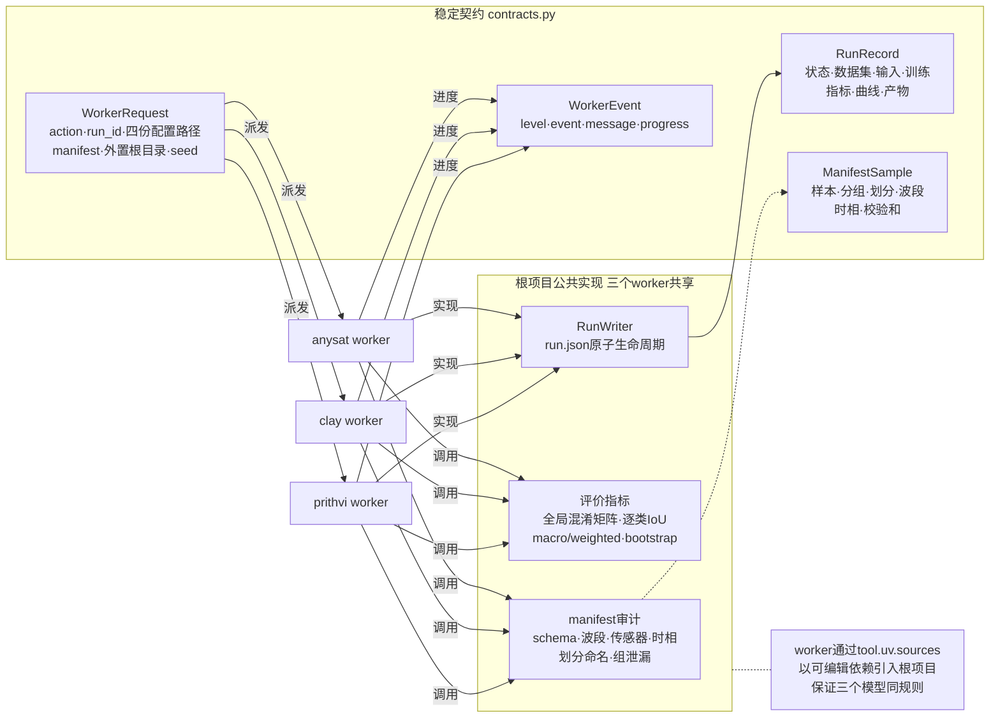
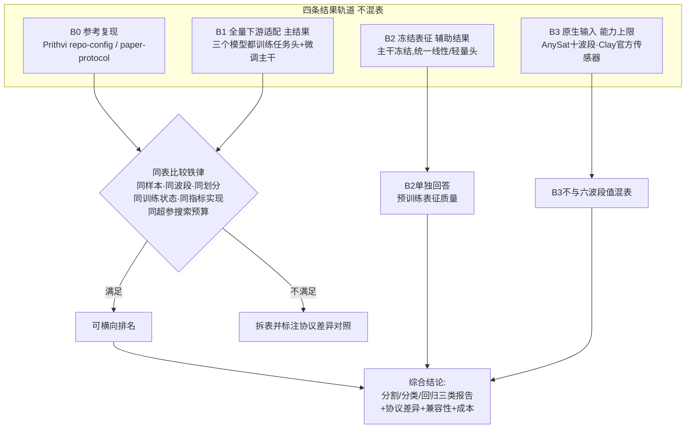

# 项目架构与运行流程

版本：v1.0 ｜ 日期：2026年10月13日 ｜ 状态：与当前代码一致

本文件用 Mermaid 图描述评测框架的分层结构、一次运行的完整数据流、以及公共层的复用关系。
配套设计文档：

- [`代码基础设施与Web_Portal设计.md`](./代码基础设施与Web_Portal设计.md)（架构与契约）
- [`数据与模型下载管理设计.md`](./数据与模型下载管理设计.md)（资源目录与下载）
- [`七任务冻结主干评测设计_AnySat_Clay.md`](../evaluation/七任务冻结主干评测设计_AnySat_Clay.md)（实验协议）

## 一、分层架构

## 二、一次运行的完整流程

## 三、契约与公共层复用

## 四、结果轨道与横向对比口径

## 五、关键设计约束

1. **控制层不导入模型代码**：`src/rs_backbone_eval` 只用 stdlib + numpy + pydantic + typer，避免与三个上游项目的依赖冲突；模型执行全部在隔离 worker 中。
2. **仓库不存 payload**：数据、权重、缓存、checkpoint、预测、日志全部在外置根目录，通过 `RS_EVAL_*` 环境变量注入；`.gitignore`、pre-commit 和 CI 卫生脚本共同防护。
3. **run.json 是唯一权威**：Portal 只读扫描，不做数据库；worker 用 `run.json.tmp` + 原子替换更新，Portal 不会读到半份记录。
4. **manifest 内容寻址**：清单按内容计算 SHA-256 并存为 `<sha256>.jsonl`，run 记录只保存哈希，保证实验可追溯。
5. **公共规则由根项目掌控**：标签映射、损失、指标、冻结检查、种子与搜索预算集中在公共层，任何模型不得私自修改。
6. **下载目录驱动**：API 只接受 `catalog.yaml` 中已声明的资源 ID，目标路径锁定在 `data`/`weights` 根目录内。
