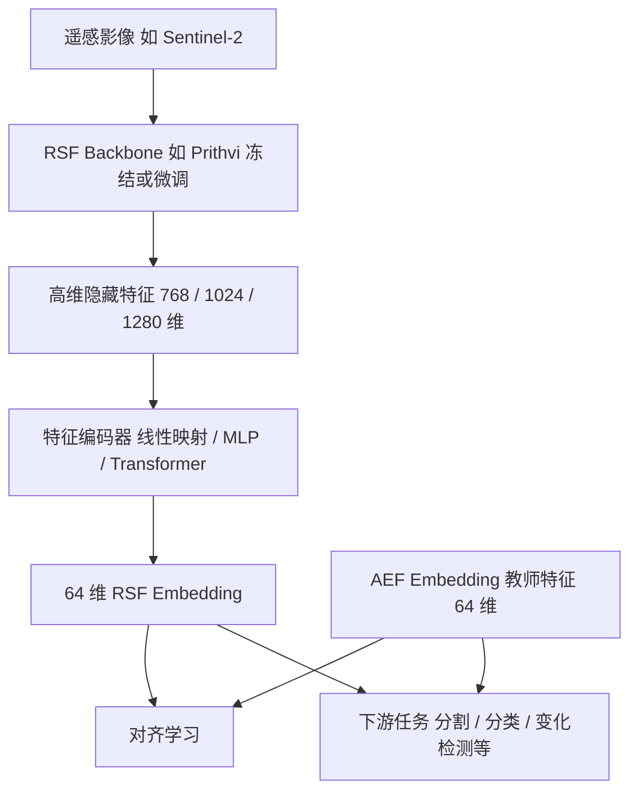

# Feature Encoder guided by AEF embedding

## 摘要

考虑到前期评测中，**<u>AEF embedding的表征能力很强</u>**（相比于其他RSF冻结+下游head的情况下，不同数据集的任务均属第一档），且AEFem开源，因此在特征层引入 AEF嵌入，引导RSF骨干输出的隐藏层特征去学习特定区域的高质量多模态表征。**<u>基本假设：64维的AEFembedding隐含更多的特征信息。核心目标：通过借助轻量的特征编码器，以及覆盖全球的开源AEF em实现面向中国地表观测的通用表征与泛化应用。</u>**

**<u>实验可行的验证标准：（1）在冻结档位下超过AEF；（2）在全量微调档位（喂全部100%标签样本 or 10%样本）下超过现有RSFs（&LIM）。</u>**

**研究目标：对齐 AEF 嵌入表征，构建紧凑的 64 维遥感特征表示。**

特征编码器将 RSF 特征映射为 64 维紧凑表征，训练架构从简单到复杂包括：

| 架构 | 结构 | 组成 | 特点 |
| --- | --- | --- | --- |
| 线性映射 | D → 64 | Linear | 参数量较小，简洁高效 |
| MLP | D → 256 → 64 | Linear、GELU、Linear | 非线性特征映射，表达能力更强 |
| Transformer | D → 256 → 64 | Linear、Self-Attention、Linear | 建模空间关系，融合上下文信息 |
| Bottleneck MLP | D → 512 → 256 → 64 | Linear、GELU、Linear 等 | 多层压缩，更强的表达能力 |
| 轻量化结构 | D → 128 → 64 | Linear、GELU、Linear | 参数更少，适合大规模训练 |

训练范式从基础到高级包括：

| 范式 | 图示说明 |
| --- | --- |
| MAE 自编码 | 重建原始特征，保留信息完整性 |
| 对比学习 | 拉近相似样本，分离不同样本 |
| 知识蒸馏 | 对齐 AEF 的 64 维表征空间 |
| JEPA 预测学习 | 预测目标特征，学习可预测语义 |
| 任务监督 | 面向下游任务，优化任务性能 |

构建与 AEF 一致的 64 维遥感嵌入，提升特征的语义一致性与跨任务泛化能力。

## 一、研究目标与总体思路

### 1.1 研究目标

本研究拟以 Google AlphaEarth Foundations（AEF）发布的64维 Satellite Embedding 作为目标表征空间，利用已有遥感基础模型（Remote Sensing Foundation Models，RSFs）的预训练 Backbone 提取高维隐藏特征，通过设计轻量级特征编码器，将 RSF 的高维特征映射到64维空间，使其在语义结构上与 AEF embedding 保持一致。

研究重点不是重新预训练一个遥感基础模型，也不是简单地将1024维特征压缩到64维，而是研究：

1.  如何利用已有 RSF Backbone 提取具有空间语义的高维隐藏特征。

2.  如何构建轻量级特征编码器，实现768/1024/1280维到64维的映射。

3.  如何利用 AEF embedding 作为教师表征，建立跨模型特征对齐机制。

4.  如何评估对齐后的64维特征在地物分类、语义分割和跨数据集迁移任务中的表现。

### 1.2 核心研究假设

AEF 已经通过大规模多源、多时相遥感观测学习了64维地理空间表征。如果能够利用具有空间和语义信息的 RSF 隐藏特征学习 AEF 的表征空间，那么就有可能在保留 RSF 特征提取能力的同时，获得与 AEF 具有较高语义一致性的紧凑型 embedding。

需要强调：研究目标是表征空间对齐（Representation Space Alignment），而不仅是特征维度压缩（Dimensionality Reduction）。

### 1.3 总体技术路线

整个研究分为三个主要阶段：数据准备、特征编码器训练和表征评估（要同时超过仅用原有骨干和仅用AEFem）。

1. **数据准备**：WHU-OPT-SAR + PASTIS + 对应位置及年份的 AEF Embedding。
2. **RSF Backbone 特征提取**：Prithvi-EO-2.0-300M / 600M，提取 768 / 1024 / 1280 维隐藏特征。
3. **特征编码器训练**：采用 Linear / MLP / Transformer 等架构，以及 MAE / 对比学习 / 知识蒸馏 / JEPA 等训练范式，输出 64 维 RSF Embedding。
4. **AEF 表征对齐**：RSF Embedding 与 AEF Embedding 对齐。
5. **下游任务验证**：地物分类 / 语义分割 / 跨区域迁移 / 跨数据集泛化。

## 二、数据准备与空间—时间对齐

### 2.1 数据集选择

初期选择 WHU-OPT-SAR 和 PASTIS 两个数据集，主要考虑它们在传感器类型、空间分辨率、地物类型和时间维度方面具有互补性。

| 数据集 | WHU-OPT-SAR | PASTIS |
| --- | --- | --- |
| 地理范围 | 中国湖北省 | 法国本土 |
| 数据来源 | GF-1 光学、GF-3 SAR | Sentinel-2 光学时序 |
| 空间分辨率 | 统一为 5m | 10m |
| 样本规模 | 100 组光学-SAR 影像对 | 2433 个时序影像块 |
| 影像尺寸 | 5556 × 3704 | 128 × 128 |
| 时间信息 | 光学与 SAR 配对观测 | 2018 年 9 月至 2019 年 11 月 |
| 标注 | 7 类土地利用类型 | 18 类作物及背景 |
| 主要用途 | 高分辨率、多模态特征对齐 | 多时相、农业地物表征对齐 |

WHU-OPT-SAR覆盖约5.1万平方公里，提供100组配准的光学与SAR影像，原始光学影像来自GF-1，SAR影像来自GF-3，统一空间分辨率为5m。

PASTIS包含2433个128×128像元的影像块，覆盖法国四个Sentinel-2区域，提供38—61期不等的多时相观测，空间分辨率为10m，包含18类作物标注。

两套数据集具有不同的研究价值：

- WHU-OPT-SAR：检验高空间分辨率、光学与SAR多模态输入条件下，RSF特征与AEF表征的对齐能力。

- PASTIS：检验多时相光学数据下，RSF特征与AEF表征的时间语义一致性，以及农业地物表征能力。

需要特别说明： 两个数据集的作用不是简单增加训练样本，而是用于检验特征编码器能否适应不同传感器、地理区域和时间条件。

### 2.2 AEF Embedding 数据获取

采用 Google Earth Engine 提供的 Satellite Embedding V1 Annual 数据集：

GOOGLE/SATELLITE_EMBEDDING/V1/ANNUAL

该产品具有以下特点：

| 属性 | 规格 |
| --- | --- |
| 特征维度 | 64 维 |
| 空间分辨率 | 10m |
| 时间范围 | 2017 年起，公开年度产品 |
| 空间覆盖 | 全球陆地区域及部分浅水区域 |
| 数据来源 | Sentinel-1、Sentinel-2、Landsat 等多源观测 |
| 特征性质 | 单位长度向量 |
| 时间组织 | 按自然年生成 |

AEF 的每个10m像元对应一个64维向量，64个波段共同构成一个完整的 embedding，不能将每个波段单独理解为某一种地物属性。

这里存在一个对整个研究设计非常重要的时间问题：当前公开的 AEF Satellite Embedding V1 是年度产品，不是逐景影像或逐日期 embedding。

例如，PASTIS 的2018年9月影像和2019年5月影像，不能分别找到完全对应日期的 AEF embedding。它们只能对应2018年和2019年的年度表征。

因此，本研究初期应将 AEF 作为年度语义教师，而不能将其误认为与每一期 Sentinel-2 观测严格同步的时相标签。

### 2.3 空间对齐：将两套数据统一到 AEF 的10m网格

本研究采用 AEF 10m 网格作为空间参考网格（Reference Grid），建立原始遥感影像、RSF 隐藏特征、AEF embedding 和地物标签之间的空间对应关系。

需要区分两个概念：

- 数据的空间分辨率统一到10m；

- 不同模型的特征 Token 具有各自的空间覆盖范围。

因此，不能仅仅将所有数据重采样到10m，就认为特征已经实现了像元级对齐。

建议的数据处理 Pipeline：

1. **获取原始数据**
   - WHU：GF-1 光学、GF-3 SAR、5m 标签。
   - PASTIS：Sentinel-2 时序、10m 标签。
   - AEF：64 维年度 embedding，10m。
2. **统一坐标参考**
   - 检查 CRS、仿射变换和地理范围。
   - 转换到对应 AEF 影像的 UTM 投影。
   - 以 AEF 的像元原点和网格为参考。
3. **统一空间分辨率**
   - 光学影像：面积加权平均或适宜的重采样。
   - SAR：先统一辐射量纲，再进行空间聚合。
   - 标签：类别众数或最近邻重采样。
   - AEF：保持原始 10m 分辨率。
4. **建立共同空间网格**：生成同一空间位置下的 RSF 输入影像、AEF 64 维特征、地物标签和有效像元掩膜。
5. **生成训练样本索引**：按照地理位置、年份、影像块编号建立一一对应关系。

具体实施时，需要注意以下细节。

（1）WHU-OPT-SAR

WHU 的原始影像和标签已经统一到5m。建议先对影像进行10m面积聚合，再与AEF网格对齐。对于地物标签，采用10m像元覆盖范围内的类别众数，避免双线性插值产生不存在的类别值。

SAR影像应注意：如果数据以 dB 表示，不宜直接将 dB 数值作为线性功率进行面积平均。应先转换到线性功率域，聚合后再按需要转换回 dB。

（2）PASTIS

PASTIS 原始影像已经是10m，因此不需要再次进行空间分辨率降采样，主要处理 CRS、仿射变换、影像边界和像元网格对齐。

（3）AEF 特征处理

AEF 的64个波段必须整体读取。若进行空间重采样，建议先对各维度进行一致的空间插值，再执行 L2 归一化：

$$
Z'_{AEF}=\frac{Z_{AEF}}{\|Z_{AEF}\|_2}
$$

这样可以尽量保持其单位球面表征性质。

需要特别注意：AEF 产品以局部 UTM 投影组织影像，不能在 GEE 中简单执行 mosaic() 后就默认获得正确的10m投影。应明确指定目标 CRS、transform 和 scale，避免默认投影改变网格。

### 2.4 特征空间与 AEF 空间的匹配

完成10m空间网格对齐后，还需要解决 RSF Token 和 AEF 像元之间的空间尺度差异。

以 Prithvi-EO-2.0 为例，其空间 Patch Embedding 使用16×16像元的空间 Patch。

假设输入影像以10m分辨率组织：

$$
16\times16\times10m=160m\times160m
$$

也就是说，一个 Prithvi 空间 Token 对应一个160m×160m的区域，而不是一个10m像元。

因此，建议采用以下匹配方法：

1.  保留10m的AEF原始64维特征图。

2.  根据 Prithvi Token 的空间覆盖范围，将对应区域内的 AEF embedding 聚合为一个64维向量。

3.  对聚合后的 AEF 向量执行 L2 归一化。

4.  与对应的 Prithvi Token 隐藏特征建立训练样本对。

例如：

$$
\begin{aligned}
X_{RSF}&\in\mathbb{R}^{B\times N\times1024}\\
Y_{AEF}&\in\mathbb{R}^{B\times N\times64}
\end{aligned}
$$

这里的 N 表示具有相同空间覆盖范围的 Token 数量。

这样才能建立真正具有空间对应关系的特征对齐样本。

**关键原则**

不应将粗粒度的 Prithvi Token 直接插值到10m，再把插值后的特征误认为真正的10m细粒度特征。可以在后续分割任务中通过 Decoder 上采样，但特征对齐阶段必须明确原始 Token 的空间支持范围。

### 2.5 时间对齐：年度 AEF 与多时相 RSF 的匹配

这是两个数据集之间需要重点处理的差异。

| 数据集 | RSF 输入时间 | AEF 教师时间 | 建议的匹配方式 |
| --- | --- | --- | --- |
| WHU-OPT-SAR | 光学、SAR 配对获取时间 | 对应自然年 | 年度 embedding |
| PASTIS | 2018—2019 年多期观测 | 2018、2019 年度 embedding | 按自然年组织观测 |

对于 PASTIS，可以采用两种实验设置：

设置 A：年度特征对齐（推荐作为主实验）

将 PASTIS 的 Sentinel-2 时序按照自然年分组，利用同一年内的多期影像提取 RSF 特征，再进行时间聚合，得到年度 RSF 特征，最后与相同自然年的 AEF embedding 对齐。

$$
\begin{aligned}
F_{RSF}^{year}&=Pool(F_{RSF}^{t_1},\ldots,F_{RSF}^{t_n})\\
F_{RSF}^{year}&\leftrightarrow E_{AEF}^{year}
\end{aligned}
$$

这种方法在时间语义上更合理，因为双方都表达年度地表状态。

设置 B：时相特征对齐（扩展实验）

对每一期 Sentinel-2 影像分别提取 RSF 特征，再使用所属自然年的 AEF embedding 作为教师特征。

但这种设置只能理解为：

单期 RSF 特征向年度 AEF 表征学习，而不是单期影像与同日期 AEF 表征之间的一一对应。

因为年度 AEF 可能包含该日期之后的观测信息。它适合研究年度语义迁移，但不适合用于严格的实时预测或因果时序预测。

如果未来需要研究真正的月度、季度或事件级时间对齐，需要进一步获取 AEF 的自定义时间窗口产品，而不能直接用年度 V1 替代。Google 的 Custom Satellite Embeddings 已提供更灵活的时间范围，但其数据获取方式与公开年度集合不同。

## 三、RSF Backbone 选择与特征提取

### 3.1 为什么选择 Prithvi？

本研究初期采用 Prithvi-EO-2.0 作为 RSF Backbone，主要考虑：

1.  具有公开预训练权重，便于复现实验。

2.  采用 ViT 架构，隐藏特征维度明确，适合构建特征压缩编码器。

3.  采用多时相 HLS 数据进行 MAE 预训练，能够提供时空遥感表征。

4.  300M 和600M两个规模可以用于研究不同 Backbone 容量对低维表征对齐的影响。

Prithvi-EO-2.0 使用 NASA HLS V2 数据进行预训练，包含约420万个样本，空间分辨率为30m，使用 Blue、Green、Red、Narrow NIR、SWIR1、SWIR2 六个波段。预训练数据覆盖全球多个地区和多个年份（2014—2023）。

### 3.2 300M 与600M版本对比

| 对比维度 | Prithvi-EO-2.0-300M | Prithvi-EO-2.0-600M |
| --- | --- | --- |
| 模型规模 | 约 300M | 约 600M |
| Backbone | ViT-Large 级 | ViT-Huge 级 |
| Transformer Blocks | 24 | 32 |
| Hidden Dimension | 1024 | 1280 |
| Attention Heads | 16 | 16 |
| Patch Size | (1, 16, 16) | (1, 14, 14) |
| 预训练方式 | MAE | MAE |
| 预训练空间分辨率 | 30m | 30m |
| 输入波段 | 6 | 6 |
| 预训练时空样本 | HLS V2 | HLS V2 |

注：Patch Size 的具体配置应以所选 checkpoint 的配置文件为准；600M 的模型实现和预训练配置需要单独核验，不能将所有版本都默认按相同 Patch Size 处理。

官方模型提供不含时间/位置编码的普通版本和含时间/位置编码的 TL 版本。TL 版本会将采集时间和地理位置编码为附加信息参与特征计算。

### 3.3 推荐的模型选择策略

推荐：300M作为主模型，600M作为扩展对照

理由：

- 300M 已具有较强的遥感特征表达能力，计算成本低于600M。

- 1024维到64维的压缩比例为16:1，便于开展编码器架构实验。

- 600M可以用于验证更高维、更大规模 Backbone 是否能够带来更好的 AEF 对齐性能。

建议实验分为：

| 实验 | Backbone | 特征维度 | 目的 |
| --- | --- | --- | --- |
| Exp-1 | Prithvi-300M | 1024 | 主实验 |
| Exp-2 | Prithvi-600M | 1280 | 验证模型规模影响 |
| Exp-3 | Prithvi-300M-TL | 1024 | 验证地理位置和时间编码的影响 |
| Exp-4 | Prithvi-600M-TL | 1280 | 验证大模型与时空信息的协同效果 |

对于你的研究，我建议优先选择 Prithvi-300M-TL，但应将普通300M作为对照组，判断时空元数据是否真正提升了 AEF 对齐效果。

### 3.4 必须考虑的传感器差异

虽然 Prithvi 预训练数据使用 HLS，但 WHU 和 PASTIS 并不完全符合其原始输入条件。

| 数据集 | 原始传感器 | Prithvi 输入兼容性 | 处理方案 |
| --- | --- | --- | --- |
| WHU-OPT-SAR 光学 | GF-1 | 部分兼容 | 需要波段适配 |
| WHU-OPT-SAR SAR | GF-3 | 不直接兼容 | 初期不直接输入 Prithvi |
| PASTIS | Sentinel-2 | 较高 | 选择对应波段并统一顺序 |

具体来说：

PASTIS：

Sentinel-2 的10个波段中，可以选取与 HLS 六波段相对应的波段：

| Prithvi 输入通道 | 对应 Sentinel-2 波段 | 说明 |
| --- | --- | --- |
| Blue | B2 | 蓝光 |
| Green | B3 | 绿光 |
| Red | B4 | 红光 |
| Narrow NIR | B8A | 窄近红外 |
| SWIR1 | B11 | 短波红外 1 |
| SWIR2 | B12 | 短波红外 2 |

因此，PASTIS 是较适合直接开展 Prithvi 特征提取的实验数据集。

WHU-OPT-SAR：

GF-1 光学数据主要提供 RGB 和近红外信息，缺少 Prithvi 预训练所使用的 SWIR 波段。因此不能直接将四个波段当成六个波段输入，也不建议通过简单复制波段来伪造 SWIR。

建议设置一个轻量级输入适配层：

$$
X_{GF1}^{4}\xrightarrow{ChannelAdapter}X_{HLS-like}^{6}\xrightarrow{Prithvi}F_{RSF}
$$

输入适配层可以单独训练，或者对 Prithvi Patch Embedding 的输入权重进行适配。

GF-3 SAR 则不应直接当作 Prithvi 的光学输入通道。初期可以将它用于：

- 对齐样本的辅助信息；

- 独立的 SAR 特征对照实验；

- 后续扩展 SAR 输入适配器或多模态 Backbone。

因此，建议将 PASTIS 作为 Prithvi-300M 主实验数据集，将 WHU-OPT-SAR 作为跨传感器、跨空间分辨率的扩展实验。

### 3.5 Backbone 特征提取策略

初期建议冻结 Prithvi Backbone，只训练新增的特征编码器。

提取过程：

1.  将输入影像按照模型要求组织为多时相 Tensor。

2.  通过预训练 Prithvi Backbone。

3.  提取最后一层 Transformer 输出的空间 Token 特征。

4.  去除不参与空间对齐的特殊 Token（如有）。

5.  保存 Token 特征及其对应的地理位置、年份和空间范围。

6.  将对应位置的 AEF embedding 聚合至相同 Token 空间支持范围。

例如，300M 输出：

$$
F_{RSF}\in\mathbb{R}^{B\times N\times1024}
$$

600M 输出：

$$
F_{RSF}\in\mathbb{R}^{B\times N\times1280}
$$

初期可以采用 FP16 保存中间特征，减少存储开销。

关于输入时相数量： Prithvi-EO-2.0 预训练采用多时相输入，默认实验配置通常使用4个时间步。PASTIS 的38—61期观测需要进行时间采样或分组，建议先从同一自然年内采样4期开始。WHU 如果没有四个真实时相，不应简单重复同一景影像并将其当成真实时序。可以先使用适配后的单时相推理配置，或将其作为独立的静态特征实验，具体需要核验所选 checkpoint 对时间维度的支持情况。

## 四、特征编码器设计与训练框架

本研究的核心模块是 Feature Encoder，其位置在预训练 Backbone 与下游任务头之间。

### 4.1 特征编码器的输入与输出

输入为 RSF Backbone 提取的高维隐藏特征：

$$
F_{RSF}\in\mathbb{R}^{B\times N\times D}
$$

输出为：

$$
Z_{RSF}\in\mathbb{R}^{B\times N\times64}
$$

其中：

- $B$：Batch Size；
- $N$：空间 Token 数量；
- $D$：Backbone 隐藏维度，取 768、1024 或 1280；
- 64：AEF 目标特征维度。

AEF 教师特征为：

$$
Z_{AEF}\in\mathbb{R}^{B\times N\times64}
$$

最终目标：

$$
Z_{RSF}\approx Z_{AEF}
$$

建议在输出端进行 L2 归一化，使 RSF 输出与 AEF 的单位球面表示具有一致的几何约束。

### 4.2 编码器架构设计

编码器架构与训练范式需要分别设计。架构决定特征如何变换，训练范式决定模型如何学习 AEF 的语义结构。

建议设置以下五种架构：

| 编号 | 编码器架构 | 结构示例 | 主要特点 |
| --- | --- | --- | --- |
| A1 | Linear Projection | D → 64 | 最简单的线性基线 |
| A2 | MLP | D → 256 → 64 | 学习非线性特征映射 |
| A3 | Bottleneck MLP | D → 512 → 256 → 64 | 逐级压缩 |
| A4 | Transformer Encoder | D → 256 → Transformer → 64 | 学习空间 Token 关系 |
| A5 | Lightweight Encoder | D → 128 → 64 | 减少参数和计算量 |

其中：

- A1 用于验证单纯线性映射是否已经能够实现 AEF 表征对齐。

- A2 作为主要候选架构，验证非线性映射的价值。

- A3 用于检验多层压缩是否能够提升表达能力。

- A4 用于检验空间上下文是否有助于 AEF 表征对齐。

- A5 用于评估模型轻量化和实际部署能力。

建议首先使用逐 Token 编码器，即每个 Token 独立映射到64维；在此基础上，再增加 Transformer 空间建模模块，避免将特征压缩能力和空间关系建模能力混在同一个实验中。

### 4.3 训练范式设计

训练范式不与编码器架构一一绑定。比如 MLP 可以使用 MAE、对比学习或知识蒸馏；Transformer 也可以采用这些训练方式。

本研究建议设置以下五类训练范式。

| 编号 | 训练范式 | 核心思路 | 在本研究中的作用 |
| --- | --- | --- | --- |
| T1 | 直接表征回归 / 知识蒸馏 | RSF 输出直接拟合对应 AEF 向量 | 建立直接对齐基线 |
| T2 | MAE | 掩码部分特征，预测被掩码位置的 AEF 特征 | 学习完整空间表征 |
| T3 | 对比学习 | 拉近对应位置的 RSF-AEF 特征，区分非匹配样本 | 学习跨模型语义相似性 |
| T4 | JEPA | 根据上下文预测目标位置的 AEF 特征 | 学习空间上下文和可预测语义 |
| T5 | 下游任务监督 | 利用分类或分割标签训练编码器 | 检验任务适应能力 |

#### T1：直接表征回归 / 知识蒸馏

这是最直接的研究基线。

以 AEF 作为 Teacher，RSF Backbone + Feature Encoder 作为 Student。

$$
Z_{RSF}=E_\theta(F_{RSF})
$$

$$
\mathcal{L}_{align}=1-\cos(Z_{RSF},Z_{AEF})
$$

也可以用 MSE 作为独立对照：

$$
\mathcal{L}_{MSE}=\|Z_{RSF}-Z_{AEF}\|_2^2
$$

训练时冻结 AEF 和 RSF Backbone，只更新特征编码器。

这一实验能够直接回答：一个轻量级编码器能否将 RSF 隐藏特征映射到 AEF 的64维语义空间？

#### T2：MAE 掩码重建

将空间 Token 随机或按块进行掩码，利用未掩码的上下文预测被掩码位置的 AEF embedding。

训练目标不是重建原始遥感影像，而是重建被掩码位置对应的 AEF 64维特征。

$$
\begin{aligned}
\hat{Z}_{AEF}^{masked}&=Decoder(Encoder(F_{RSF}^{visible}))\\
\mathcal{L}_{MAE}&=\|\hat{Z}_{AEF}^{masked}-Z_{AEF}^{masked}\|_2^2
\end{aligned}
$$

它可以研究：通过空间上下文学习，是否能够得到比直接逐 Token 映射更稳定的 AEF 对齐特征。

#### T3：跨模型对比学习

将同一位置的 RSF 特征和 AEF embedding 作为正样本对，不同位置的样本作为负样本。

$$
(F_{RSF}^{i},Z_{AEF}^{i})
$$

利用 InfoNCE 等对比损失，让两种模型在共享的64维空间中具有一致的相似性关系。

需要特别注意遥感数据中的空间邻近性：相邻像元可能属于同一种地物，不能简单将所有其他位置都视为负样本。建议采用空间间隔筛选、类别辅助或去除潜在假负样本等策略。

#### T4：JEPA 预测学习

JEPA 不直接重建输入，而是利用上下文特征预测目标区域的 AEF embedding。

可以设计：

- Context Encoder：提取可见区域的 RSF 特征；

- Predictor：预测目标区域的64维 embedding；

- Target Encoder：提供目标位置的 AEF embedding。

$$
\begin{aligned}
\hat{Z}_{target}&=Predictor(Z_{context})\\
\mathcal{L}_{JEPA}&=\|\hat{Z}_{target}-Z_{AEF,target}\|_2^2
\end{aligned}
$$

这里 AEF 作为目标表征来源，RSF 作为上下文信息来源。

该方法适合研究空间结构、地物邻域和地理上下文是否有助于学习 AEF 的语义表征。

#### T5：下游任务监督

利用 WHU-OPT-SAR 的7类土地利用标签和 PASTIS 的18类作物标签，直接优化编码器输出。

例如：

$$
F_{RSF}\rightarrow E_\theta\rightarrow Z_{64}\rightarrow TaskHead
$$

通过交叉熵等任务损失训练编码器。

这一方案不再严格要求输出与 AEF 的每个维度完全对应，而是让64维特征适合特定下游任务。因此，应将其作为任务性能对照，而不是直接等同于 AEF 蒸馏。

### 4.4 编码器架构与训练范式的组合实验

为了避免实验数量过多，不建议一开始就进行五种架构与五种训练范式的全排列。建议分阶段开展。

| 实验阶段 | 编码器架构 | 训练范式 | 实验目的 |
| --- | --- | --- | --- |
| 第一阶段 | PCA | 无监督降维 | 建立传统降维基线 |
| 第二阶段 | Linear | 直接表征回归 | 验证线性对齐能力 |
| 第三阶段 | MLP | 直接表征回归 | 验证非线性对齐能力 |
| 第四阶段 | MLP | MAE | 验证掩码特征预测 |
| 第五阶段 | MLP | 对比学习 | 验证跨模型语义关系 |
| 第六阶段 | Transformer | JEPA | 验证空间上下文预测 |
| 第七阶段 | MLP / Transformer | 下游任务监督 | 验证任务性能及其上限 |

这里有一个重要的实验逻辑：

- PCA 和 Linear 是压缩及对齐的基础对照。

- MLP 是主要的轻量级特征编码器。

- MAE、对比学习和 JEPA 是不同的表征学习策略，分别独立训练。

- 下游任务监督用于判断特定任务能否进一步优化64维特征。

我建议将 MLP + AEF 直接蒸馏作为主实验，将 MAE、对比学习和 JEPA 作为扩展实验。

原因是研究的核心目标是 AEF 表征对齐，而不是从头探索一种新的自监督预训练范式。直接蒸馏能够最清晰地验证核心假设。

## 五、训练实施与实验设计

### 5.1 训练流程

初期采用冻结 Backbone 的两阶段训练方式。

**阶段一：特征提取**

1. 冻结 Prithvi 预训练 Backbone。
2. 提取高维空间 Token 特征，维度为 1024 / 1280。
3. 与同位置、同年度的 AEF embedding 建立匹配关系。

**阶段二：特征编码器训练**

1. 训练 Feature Encoder，将 1024 / 1280 维映射到 64 维。
2. 进行 AEF 表征对齐，根据不同实验选择一种训练范式。
3. 输出 64 维 RSF Embedding。

第一阶段将 Backbone 特征离线缓存，第二阶段直接读取缓存特征训练编码器，可以避免反复执行数亿参数模型的前向推理。

在初步验证成功后，再考虑解冻 Backbone 的最后几个 Transformer Blocks，开展联合微调实验，研究 Backbone 适应 AEF 表征空间后能否进一步提升对齐性能。

### 5.2 数据集划分与防止空间泄漏

这一部分需要特别注意，不能简单地将所有影像块随机打乱后划分训练集、验证集和测试集。

| 数据集 | 推荐划分策略 | 主要目的 |
| --- | --- | --- |
| WHU-OPT-SAR | 按原始地理影像区域划分 | 避免相邻 Patch 泄漏 |
| PASTIS | 使用官方五折划分 | 保持基准评测协议 |
| 跨数据集验证 | WHU 训练、PASTIS 测试，及反向实验 | 检验跨区域泛化 |

建议将 PASTIS 官方五折划分中的训练、验证和测试区域严格分开。

WHU 则按照原始影像及其地理范围划分，确保同一原始影像裁切出来的相邻 Patch 不会同时进入训练集和测试集。

此外，AEF embedding 的使用也要遵循同样的划分规则，不能利用测试集的地物标签参与编码器训练。

### 5.3 评价指标

建议从三个层次评价研究效果。

#### 第一层：AEF 表征对齐能力

| 指标 | 含义 |
| --- | --- |
| Cosine Similarity | RSF 与 AEF 对应向量的余弦相似度 |
| MSE | 两个 64 维向量之间的均方误差 |
| CKA | 比较不同模型表征空间的整体相似性 |
| Retrieval Recall@K | 检验对应地理位置的特征能否被正确检索 |

其中，Cosine Similarity 应作为主要对齐指标，同时报告不同空间区域、地物类型和年份的分组结果。

#### 第二层：下游任务性能

| 数据集 | 任务 | 评价指标 |
| --- | --- | --- |
| WHU-OPT-SAR | 7 类土地利用分类/分割 | OA、mF1、mIoU |
| PASTIS | 18 类作物语义分割 | mIoU、mF1、OA |
| PASTIS | 地块识别（扩展） | PQ、SQ、RQ |

建议使用相同的下游任务头、相同的训练集比例和相同的训练配置，比较：

1.  原始 RSF 高维特征；

2.  PCA 64维特征；

3.  编码器输出的64维 RSF 特征；

4.  AEF 原生64维特征。

这样可以回答一个重要问题：经过编码器对齐后，RSF 的64维 embedding 是否能够达到接近 AEF 原生 embedding 的下游任务表现。

#### 第三层：迁移与泛化能力

重点开展：

- WHU 与 PASTIS 之间的跨数据集迁移；

- 不同地理区域之间的迁移；

- 不同年份之间的迁移；

- 不同 Backbone（300M、600M）之间的表征比较。

## 六、关键实验风险与解决方案

| 关键问题 | 可能产生的影响 | 建议解决方案 |
| --- | --- | --- |
| AEF 是年度产品 | 无法与单期影像严格时间匹配 | 以年度表征作为主实验目标 |
| GF-1 缺少 SWIR 波段 | 与 Prithvi 原始输入不兼容 | 设置 4 → 6 通道输入适配层 |
| GF-3 SAR 不是光学数据 | 不能直接输入 HLS 预训练 Backbone | 先独立处理，后续研究 SAR 适配 |
| Prithvi Token 覆盖范围大于 AEF 像元 | 无法直接逐像元对齐 | 按 Token 实际空间范围聚合 AEF |
| 不同地区特征分布差异 | 跨区域泛化能力下降 | 进行空间独立验证 |
| AEF 和 RSF 表征空间不同 | 直接 MSE 可能难以优化 | 同时比较余弦相似度和 MSE |
| 年度 AEF 存在未来信息 | 影响严格时序预测结论 | 不将年度蒸馏结果解释为实时预测能力 |

特别是最后一点：如果研究进一步扩展到变化检测或未来地表状态预测，不能使用包含未来观测的年度 AEF embedding 作为历史时刻的教师标签，否则会出现时间信息泄漏。

## 七、预期研究成果与阶段安排

### 7.1 预期成果

本研究希望形成三个主要成果：

1.  RSF-AEF 特征对齐方法： 建立一套针对已有遥感基础模型隐藏特征的64维编码方法。

2.  轻量级特征编码器： 比较 Linear、MLP、Transformer 等架构在不同训练范式下的性能差异。

3.  跨区域、跨任务表征评测体系： 验证对齐后的64维特征是否具有较好的地理空间语义一致性和迁移能力。

### 7.2 建议实施顺序

| 阶段 | 主要工作 | 预期产出 |
| --- | --- | --- |
| 第一阶段 | WHU、PASTIS 数据整理及 AEF 获取 | 空间—时间对齐样本 |
| 第二阶段 | Prithvi-300M 特征提取 | 1024 维隐藏特征库 |
| 第三阶段 | PCA、Linear、MLP 基线实验 | 初步 64 维对齐结果 |
| 第四阶段 | MAE、对比学习、JEPA 实验 | 不同训练范式对比 |
| 第五阶段 | Prithvi-600M 扩展实验 | Backbone 规模影响分析 |
| 第六阶段 | 下游任务及跨数据集评测 | 表征迁移能力评价 |

## 八、最终推荐的主实验方案

综合研究目标、计算成本和实验可操作性，我建议将下面这条路线作为第一版正式实验方案：

**优先实施：Prithvi-300M + MLP + AEF 知识蒸馏。**

| 模块 | 配置 |
| --- | --- |
| 数据集 | PASTIS 优先，WHU 扩展 |
| 教师模型 | AEF 64 维年度 Embedding |
| 学生 Backbone | Prithvi-EO-2.0-300M-TL |
| Backbone 训练状态 | 冻结 |
| 原始特征 | 1024 维 |
| 编码器 | MLP：1024 → 256 → 64 |
| 输出 | 64 维、L2 归一化 |
| 训练范式 | 直接表征蒸馏 |
| 对齐损失 | Cosine Loss，MSE 作为独立对照 |
| 下游验证 | PASTIS 语义分割、WHU 土地利用分类/分割 |

扩展实验则依次加入：

- Linear Projection：判断非线性编码是否必要；

- MAE、对比学习：比较不同自监督学习方式；

- Transformer + JEPA：研究空间上下文预测；

- Prithvi-600M：研究更大 Backbone 是否能够形成更好的低维表征。

最重要的研究判断： 本研究最终需要证明的不是“1024维能够变成64维”，而是“通过合理的编码器架构和训练范式，可以将已有 RSF 的高维隐藏特征映射到与 AEF 一致的64维地理空间语义表征，同时尽可能保留其下游任务能力”。这才是整项研究真正的创新主线。

## 参考资料

1.  [Google Satellite Embedding V1 官方数据说明](https://developers.google.com/earth-engine/datasets/catalog/GOOGLE_SATELLITE_EMBEDDING_V1_ANNUAL?hl=en&utm_source=chatgpt.com)

2.  [Prithvi-EO-2.0-300M 官方模型说明](https://huggingface.co/ibm-nasa-geospatial/Prithvi-EO-2.0-300M/blob/main/README.md?utm_source=chatgpt.com)

3.  [Prithvi-EO-2.0 原始论文](https://ntrs.nasa.gov/api/citations/20240015391/downloads/RSE%20Prithvi%20Global.pdf?attachment=true&utm_source=chatgpt.com)

4.  [WHU-OPT-SAR-dataset/README.md at main · AmberHen/WHU-OPT-SAR-dataset · GitHub](https://github.com/AmberHen/WHU-OPT-SAR-dataset/blob/main/README.md?utm_source=chatgpt.com)

5.  [GitHub - VSainteuf/pastis-benchmark · GitHub](https://github.com/VSainteuf/pastis-benchmark?utm_source=chatgpt.com)
