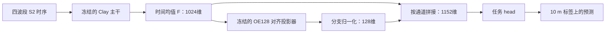

# 高维特征与教师投影拼接：agent 执行交接

日期：2026-11-13。状态：待实现、待运行；本文不代表已有实验结果。

用户希望保留已有的 1024 维主干表示，单独用公开 AEF/OlmoEarth embedding 训练
64/128 维投影器，再把原始表示与投影表示一起送入任务 head。本文件固定首轮实验，
供执行 agent 直接实施。仓库操作遵循根目录 [AGENTS.md](../../AGENTS.md)。
撰写时参考代码为 `8dd4c4b`；执行时先检查最新代码和部署状态。

## 1. 要回答的问题

在**同一份冻结主干权重、同一输入与训练预算**下，分类头同时读取 `F` 与
`E_teacher(F)`，能否优于只读取 `F`，以及读取 `F` 与随机非线性投影的对照？



推理只需要输入影像、主干、投影器和 head，不读取真实教师 embedding。
`E(F)` 是 `F` 的函数：可能让有限容量的 head 更容易利用已有信息，但不能据此声称
补回了输入中没有的传感器或时相信息。首轮也不验证跨地区泛化。

现有 AnySat `wide_distill` 是“head 读取 F，教师投影只用于辅助损失”；本方案是
“冻结 F/E 后，head 显式读取两条特征分支”。两者单独成轨，不混为同一实验。

## 2. 首轮范围：Clay T11D + OE128

| 项 | 固定设置 |
|---|---|
| 学生 | `clay_v1_5`，1024 维 token |
| 任务 | `T11D`，PASTIS-HD 四波段输入 |
| 输入 | B02/B03/B04/B08，2019-only，按现有规则至多 20 帧 |
| 输入网格 | 每帧 128×128，10 m |
| 特征 | stride 8，16×16 token；按时间求均值后得到 F |
| 教师 | OlmoEarth v1.3 2019，128 维 |
| 标签与 split | 与 T11D 固定 manifest 一致；1455/482/496 train/validation/test |
| 指标 | 在 128×128 的 10 m 标签上算 mIoU；背景 0 有效，void 19 忽略 |
| 种子 | 17/42/73，全部预声明、全部报告 |
| 准入 | 本轮所有协议与结果均为 diagnostic；不进入 headline、D1 或旧 cell |

manifest 参考：

```text
/geodata/rs-eval/data/manifests/T11D/8e674fc75f1b878cf4688a323666e68601b6ffb1baa942bac6029795b45541a6.jsonl
```

先用 doctor 确认实际根目录，再核对文件 SHA、行数、sample_id/split/group_id；不要
假设本机与源机的路径相同。teacher payload 使用同一批 patch 的
`derived/olmoearth-2019-128/features/2019/<sample_id>.npz`。

首轮不扩展 AnySat、Prithvi、AEF64、双教师、跨域迁移或联合微调。
AEF64 和 `[F,E_A64(F),E_O128(F)]` 留到首轮判断后，不能自行展开全排列。

## 3. 固定主干来源，保留已有 1024 维能力

源协议固定为 `clay_rgbn_ft_last4_raw1024`：已有 T11D、末 4 块适配、无投影器的
1024 维宽头模型。按源训练 seed 17/42/73 各取一份权重，同 seed 的所有实验臂
共享这份 F；不按 test 分数挑 seed 或挑 checkpoint。

执行 agent 先从真实账本解析来源，输出 `source_lock.json` 到仓库外的审计目录，记录：

- source run_id、git_commit、协议、seed、init、label_fraction、manifest SHA；
- 原始 Clay checkpoint SHA、适配后 model.pt SHA、上游 Clay commit；
- bands、帧选择、预处理、token 网格、源训练预算与审计判定。

使用 completed、完整 8 epoch、pretrained、100% 标签、未 superseded、审计合规的
对应来源。源协议本身是 diagnostic，本轮子实验继续保持 diagnostic，不能借用权重
把它升级成正式结果。存在重跑时依照账本的 canonical 规则解析，不按最高分选取；
有不同 variant 的歧义时先核实身份，不能随意选最新文件。

恢复源模型时，先加载 SHA 匹配的原始 Clay checkpoint，再覆盖 `model.pt` 的
`backbone.*` 适配参数。校验应覆盖的末 4 块和 final norm，拒绝未知 key、维度错误和
适配权重缺失；不能用一个不检查 missing/unexpected keys 的 strict=False 蒙混通过。

保留源 head 文件供恢复验证，但本轮三臂的 head 都重新训练。**新基线不能直接使用
旧 head 的历史分数**：源模型联合适配和“固定 F 后新训练 head”是不同训练过程。

所有 F 参数与 buffer 在后续阶段保持不变、处于 eval。主干换了 checkpoint，就必须
重新训练与之绑定的 E；不要直接拿旧冻结主干上的投影器套在适配后 F 上。

## 4. 三个实验臂与共同初始化

| 臂 | head 输入 | 训练 head 前的状态 |
|---|---|---|
| R：原始基线 | F，1024 维 | F 冻结 |
| X：随机投影对照 | `[F,N(E_init(F))]`，1152 维 | F 和随机 E 冻结 |
| T：教师投影拼接 | `[F,N(E_teacher(F))]`，1152 维 | F 和教师训练后的 E 冻结 |

`E_init` 与 `E_teacher` 是同一结构：`Conv1×1(1024,256) → GELU → Conv1×1(256,128)`。
每个 seed 先保存一份 E 初始 state；X 保留这个 state，T 从其副本开始教师训练。
X 不经过教师或任务标签训练。这样 X/T 结构、维数和 head 参数量一致。

分支归一化固定为逐 token、沿通道：

```text
N(z) = sqrt(128) * z / max(||z||_2, 1e-6)
```

X/T 使用完全相同的 N；F 分支沿用源预处理与数值，不额外改归一化。首轮不搜索
gate、分支权重、MLP 深度或归一化配方。

head 沿用 `Conv1×1 → 128 hidden → GroupNorm(8) → GELU → Conv1×1 → 20 类`。
每个 seed 先生成一个共同的 1024 维 head 初始 state；X/T 把第一层扩展为 1152 输入，
复制原来的 1024 通道权重，新增 128 通道权重初始化为 0，其余参数全部复制。
因此三臂训练前 logits 应一致，X/T 的 head 初始 state 完全一致。

投影器初始化用独立 RNG；head 初始化和每轮样本排列也分别固定 Generator，不能
因额外创建 E 或预计算特征而改变共同初始化/顺序。相同 seed 的三臂共用相同训练行顺序。

## 5. 两阶段训练与评测

### 阶段 A：只训练教师投影器

- F 冻结、eval；只训练 T 的 E，8 epoch，AdamW，lr=3e-3，weight_decay=1e-4。
- 有效 batch=2 patch。用教师有效支持上的 `mean(1-cos(E(F), teacher))`；不加 CE。
- 沿用已有正确的 int8 反量化和 8×8 有效像元均值聚合，得到 128×16×16 教师目标；
  余弦损失中按通道归一化，不直接对原始 int8 算余弦。
- 只在 train split 更新 E。允许用 validation cosine 选择这 8 epoch 内的 best E；
  不用 test 教师目标选 epoch，不用下游 test 分数挑 E。
- 保存 E_init、E_best、best_epoch、训练/验证曲线和主干/教师身份。教师缺文件或对齐
  身份不一致应报告并停在数据验收，不能静默删样本或改 split。
- teacher 的无支持 token 不参与余弦。标签全 void 不等于教师无观测，二者分开处理。

### 阶段 B：分别训练 R/X/T 的新 head

- 冻结 F、E_init、E_best；只训练各自 head，8 epoch，AdamW，lr=3e-3，wd=1e-4。
- 三臂共用 manifest、样本顺序、精度、head hidden width、预算、有效 batch=2。
  同一 cell 固定 host/GPU class 和微批/累积组合，记录实际配置。
- token logits 双线性上采样到 128×128，align_corners=False；对原始 10 m 标签
  算 CE 与 mIoU。不要照搬历史配置中的“多数票标签评测”描述。
- 全 void 微批跳过，且不计入累积窗口；尾窗按实际有效样本数归一化并记录。
- 首轮 head 使用第 8 epoch 权重，不做 early stopping，不从 test 选择 checkpoint。
- validation/test 实际评测数分别必须为 482/496，并写标准 evaluated/manifest/expected
  tags。任何样本、步数或 epoch cap 都是独立 smoke，不能证明完整预算结果。

先运行 seed 17 的短 smoke 验证工程路径；通过后完整执行三 seed，不根据 seed 17 的
test 好坏决定是否补 42/73。首轮共 3 个 E 训练 + 9 个 head 训练，源 F 不重新微调。

## 6. 缓存、产物和来源约束

F 可缓存为时间均值后的 `(1024,16,16)`，默认 float32，保持原来的时序聚合顺序与
计算精度。每个 seed 的全 split 缓存约 2.4 GiB；3 seed 约 7.2 GiB，实际以文件为准。
首次抽样验证在线/缓存特征与 logits 一致，再全量生成；特征提取固定 manifest 顺序。

缓存与 E 的身份至少绑定：task、manifest、源适配后权重 SHA、原始 checkpoint SHA、
输入 bands/frames/预处理、上游版本、网格、时间聚合、dtype 与代码版本。E 还需绑定
teacher 产品/年份/维度/编码/提取版本、训练 seed、预算与诊断身份。

数据、特征与权重放仓库外；新大体积缓存遵循 AGENTS 的 `/home/yzhong/...` 布局，
不要塞进 `/geodata` 的有限剩余空间。原子写入、校验 shape/dtype/身份，拒绝半文件。

smoke 与完整诊断预算必须分开命名空间；不能只靠 epochs 区分，因为“8 epoch +
LIMIT_BATCHES=1”仍是 smoke。不能覆盖源模型或其他运行的 adapter/projector 缓存。
加载父产物时校验来源 run、预算、审计状态及 SHA，不能只看文件名或目录唯一性。

每个完成的 head run 必须保存可恢复的 checkpoint：head、分支配置、必要的冻结 E
副本、精确归一化、源 F/base checkpoint 身份及融合通道顺序。不得只存指标。
源 F 可按 SHA 引用受保护的权重；冻结 E 应复制入对应 run，避免共享缓存改变后失去
可恢复性。保存后重新加载并比较 logits，确认真实产物完整。

源权重、E、head 和 run.json 全部保留；重试使用新 run_id，不手写/修改旧 run.json。

## 7. 仓库实现与执行顺序

1. 运行 doctor，检查本地/部署仓库状态与活跃队列。部署仓库有运行任务时，在独立
   worktree 实现；不要 stash、改正在被 Bash 延迟读取的队列脚本或打断其他实验。
2. 完成 source_lock 与数据/teacher 对齐验收。原有宽头来源无法完整恢复时先报告，
   不偷偷换成原始预训练 F，也不挑另一条高分 run 代替。
3. 在 Clay worker 内实现，不给根控制层引入 torch/rasterio。可以复用 rgbn 的
   frame/teacher/head helper，新增路径应与旧主干训练路径解耦。
4. 建议协议 ID：`clay_rgbn_fusion_o128_fit`、`clay_rgbn_fusion_raw`、
   `clay_rgbn_fusion_rand_o128`、`clay_rgbn_fusion_teacher_o128`。
   它们均属 T11D、train_backbone=false、train_input_adapter=false、panel=diagnostic；
   对 fit 来说 head 是 E，对另外三者 head 是任务分类头。按实际 Registry schema 落地。
5. 注册独立 track、diagnostic 准入，更新 runner 允许列表、精确集合测试；不要并到
   既有 BRF/BRF1024/B2 cell。验证 report 与 Portal 的准入一致。
6. 先跑 CPU stub 回归，再跑小规模 dispatch smoke；smoke 不能覆盖正式共享路径。
7. 在干净、已提交并通过检查的实现版本上，通过 dispatch 创建完整预算 run；在仓库外
   保留 bundle。为 `rerun_baselines.sh` 增加独立 lane，空闲 GPU 上 detached 串行执行。
   先测量少量编码和一轮 head 的耗时，给出队列预算，避免虚构总时长。
8. 诊断新路径不自动升级为主结果。若顺便修复会改变旧落盘指标的共享代码，必须
   将修复提交登记到 audit.required_fixes，审计并明确受影响范围。

最低 CPU 回归覆盖：三臂初始 logits 一致；F/E 无梯度且 state 不变；E 仅从 train
更新；归一化和拼接维数正确；冷/热缓存顺序一致；不同父权重拒绝复用；smoke 不可
覆盖完整预算产物；void/尾累积正确；完整 artifact 往返；诊断不进正式矩阵。
完成 ruff check、format --check、pytest、hygiene；worker 测试使用自己的环境。

## 8. 预声明的判断规则与交付物

主要比较是同 seed 的 **T−R** 与 **T−X**，依据 validation mIoU 决定是否扩展。
报告三 seed 的逐项分数、配对差、mean±std，以及编码/投影/head 的计算和存储成本。

- 验证成功门槛：T−R、T−X 的 validation 三 seed 均为正，且各自平均差至少 0.01
  （1 个 mIoU 百分点）。达到门槛后再考虑 AEF64、双教师或联合微调。
- T 超过 R、但未稳定超过 X：只能支持增加分支/非线性读出的收益，不能归因于教师。
- T 没有稳定超过 R：报告“当前冻结配方未显示收益”，不能换 test 最好的 seed 讲故事。
- test 在配方冻结后统一报告；不据 test 调目标、宽度、loss、gate 或训练轮数。
  三 seed 是工程复核，不等于跨区域泛化或普遍有效性证明。

原先宽头的历史分数只作背景；本轮结论必须用重新训练的 R/X/T 自己的对照表。
源模型已有标签训练，本轮不是“无标签获得所有能力”或从零训练预算比较。

交付：

- 代码、协议、lane、CPU 测试和验证结果；
- 仓库外的 source_lock、缓存身份、run_id、artifact 路径、训练/评测数量、预算；
- 三种子结果与失败记录、在线/缓存与 checkpoint 往返验证；
- 中文实验记录：是否达到上述门槛、剩余局限、后续是否扩展。

## 9. 可直接交给执行 agent 的说明

> 阅读 AGENTS.md 和本文，实现并运行 Clay T11D 的冻结高维特征/教师投影拼接诊断。
> 按 seed 17/42/73 固定已有 raw1024 宽头主干，重新训练 OE128 投影器；在同一 F 上
> 比较 R、X、T，三臂共同初始化、相同预算。先完成身份和产物恢复验收、CPU 测试及
> smoke，再从干净提交 detached 串行跑完整预算。保留全部 run 和权重，严禁诊断
> 污染共享缓存。按 validation 的 T−R/T−X 预声明规则汇报，不自行扩展目标或用 test
> 选配方。无法恢复指定源权重时报告具体原因，不替换实验问题。
