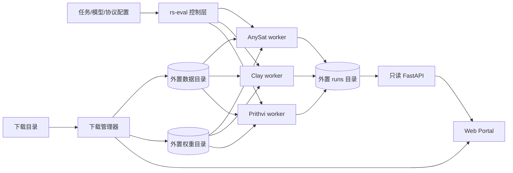

# 代码基础设施与 Web Portal 设计

版本：v1.1 ｜ 日期：2026年10月12日 ｜ 状态：基础骨架与公共数据/指标层已落地，模型worker待实现

## 一、目标

仓库只保存代码、配置、协议、测试和文档。以下内容全部位于Git仓库之外：

- 原始数据、处理后数据和manifest产物；
- AnySat、Clay、Prithvi模型权重；
- 冻结特征缓存、checkpoint、优化器状态；
- 预测栅格、案例图、日志和实验结果。

控制层、模型执行层和结果展示层通过稳定的数据契约连接。Portal只读实验结果，不接触训练进程，也不需要GPU；独立的下载管理器只向外置data/weights目录写入目录中已声明的资源。

## 二、总体架构



选择隔离worker的原因是三个上游项目可能要求不同Python、PyTorch、CUDA、Flash Attention和TerraTorch版本。控制层不导入模型包，避免环境冲突。

## 三、仓库结构

```text
rs-backbone-eval/
├── configs/
│   ├── tasks/               # 8份可执行任务配置
│   ├── models/              # AnySat/Clay/Prithvi入口
│   ├── protocols/           # B0/B1/B2/B3训练状态
│   └── downloads/           # 官方资源URL、容量、校验值与目标目录
├── src/rs_backbone_eval/
│   ├── contracts.py         # run.json稳定契约
│   ├── registry.py          # 配置校验（含每任务划分策略）
│   ├── paths.py             # 外置路径解析
│   ├── results.py           # 文件结果索引
│   ├── cli.py               # doctor/list/audit/validate/portal
│   ├── data/
│   │   ├── manifest.py      # 清单写入、内容哈希、任务感知split审计
│   │   └── sequence.py      # GeoSequenceSample与流式加载
│   ├── evaluation/          # 分割/分类/回归公共指标与bootstrap
│   └── portal/app.py        # 只读API
├── web/                     # 无Node构建步骤的Portal
├── workers/                 # 三个隔离模型环境
├── scripts/                 # 仓库卫生与schema导出
├── tests/                   # 契约、API和注册表测试
├── docs/
├── .github/workflows/ci.yml
├── .gitignore
└── pyproject.toml
```

## 四、外置存储

生产环境建议将四个根目录放在独立磁盘、NAS或对象存储挂载点：

```text
/mnt/rs-eval/
├── data/
│   ├── raw/<dataset>/<version>/
│   ├── processed/<task>/<preprocessing_id>/
│   └── manifests/<task>/<manifest_sha256>.jsonl
├── weights/<model>/<checkpoint_sha256>/
├── cache/<model>/<task>/<feature_cache_key>/
└── runs/<run_id>/
    ├── run.json
    ├── resolved_config.yaml
    ├── checkpoints/
    ├── predictions/
    ├── previews/
    ├── tables/
    └── logs/
```

环境变量只保存根路径，不把个人绝对路径写进配置：

```text
RS_EVAL_DATA_ROOT
RS_EVAL_WEIGHTS_ROOT
RS_EVAL_RUNS_ROOT
RS_EVAL_CACHE_ROOT
```

## 五、核心契约

### 5.1 TaskSpec

任务注册表定义数据集、任务类型、传感器、时相、波段、输出数和主指标。模型worker不能私自修改标签映射或主指标。

### 5.2 数据manifest

每条样本至少包含：

```text
task_id, sample_id, group_id, split, image_paths, label_path,
sensor, bands, timestamps, temporal_mask, crs, transform, gsd_m, checksum
```

manifest按内容计算SHA-256。run记录只保存哈希和外置位置，不复制数据。

### 5.3 run.json

每个运行目录必须且只允许有一个权威 `run.json`。主要字段包括：

- `run_id/task_id/model_id/protocol_id/seed/status`；
- 数据版本、manifest哈希和split；
- 输入传感器、波段、时相和预处理ID；
- 训练状态、head、可训练参数量、step、耗时和显存；
- 主指标、辅助指标、逐类指标和训练曲线；
- 指向同一运行目录内产物的相对路径。

路径必须为相对路径且不能包含 `..`。Portal API在返回产物前再次执行目录边界检查。

## 六、执行组件

### 6.1 控制层

控制层负责：

1. 校验任务、模型、协议组合；
2. 解析环境变量和外置路径；
3. 生成模型×任务×协议×seed运行矩阵；
4. 启动相应worker并转发取消/失败状态；
5. 校验worker生成的run记录；
6. 汇总协议一致性和缺失组合。

控制层本身不导入torch、rasterio或任何模型代码。

### 6.2 模型worker

每个worker实现相同动作：

```text
probe              验证真实小样本前向、shape、波段和元数据
extract_features   为B2写冻结特征缓存
train              执行B0/B1/B2/B3训练
evaluate           使用公共指标定义评价checkpoint
export_previews     输出有限数量的PNG案例图和误差图
```

worker必须定期原子更新 `run.json`。先写 `run.json.tmp`，完成校验后再替换，Portal不会读到半份JSON。控制层通过 `WorkerRequest` 传递动作、四份配置路径、manifest和外置根目录；worker可用逐行 `WorkerEvent` 回传进度，避免依赖某个训练框架的日志格式。

### 6.3 训练与评价公共层

模型特定代码只负责输入适配和特征/预测。以下逻辑保持公共：

- split与group防泄漏检查；
- loss、标签映射和ignore mask；
- segmentation/classification/regression指标；
- seed、搜索预算和early stopping；
- checkpoint选择和最终split门禁；
- backbone冻结哈希与梯度检查；
- run记录和报告生成。

## 七、Web Portal

当前Portal已经提供：

- 总运行数、完成数、运行中和无效记录；
- task/model/protocol/status筛选；
- 单任务下按模型与协议聚合的主指标均值和样本标准差；
- 8份配置的运行覆盖；
- 运行表格和详情抽屉；
- 输入波段、可训练参数、耗时、全部指标和学习曲线；
- preview、confusion matrix、report等外置产物链接；
- 非法或损坏run记录提示；
- 3个模型权重与7个数据资源的本地状态、容量和官方来源；
- aria2/Hugging Face/GCS后台下载、暂停续传、速度、ETA与完整性校验。

实验结果API保持只读，下载操作API只能选择目录中已有的资源ID：

```text
GET /api/health
GET /api/summary
GET /api/runs
GET /api/runs/{run_id}
GET /api/artifacts/{run_id}/{relative_path}
GET /api/downloads
GET /api/downloads/{resource_id}
POST /api/downloads/{resource_id}/start
POST /api/downloads/{resource_id}/pause
POST /api/downloads/{resource_id}/verify
```

首版使用目录扫描，不引入数据库。数百个run仍足够快；如果增长到数万条，再增加由run.json构建的SQLite/DuckDB只读索引，run.json继续作为权威来源。

## 八、GitHub仓库防护

- `.gitignore` 同时按目录和扩展名排除数据、权重、checkpoint及地理影像；
- pre-commit拒绝大于1 MiB的新文件；
- CI卫生脚本拒绝常见模型/数据扩展名和大于5 MiB的文件；
- 不使用Git LFS，因为目标是完全不提交payload；
- `.env`、密钥和个人绝对路径不提交；
- 配置只引用环境变量名、dataset ID、checkpoint哈希和上游URL。

## 九、后续实现顺序

1. ✅ 公共dataset manifest、split审计和指标模块（`data/manifest.py` 确定性清单写入与内容哈希、任务感知审计 `rs-eval audit-data`；`data/sequence.py` 统一样本流；`evaluation/` 分割/分类/回归指标、逐类IoU与bootstrap置信区间）；
2. 实现Prithvi worker，先跑通T1 repo-config基线（T1数据审计已完成：Sen1Floods11 hand-labeled 446景manifest已由 `rs-eval build-manifest --task T1` 生成并通过契约审计；Prithvi-EO-2.0 300M-TL权重已下载校验）；
3. 实现AnySat/Clay的S2 probe，跑通T1；
4. 实现HLS输入适配，跑通T2；
5. 补齐时序分割、分类和回归head；
6. Portal增加混淆矩阵、空间案例并排和协议差异页；
7. 锁定P1配置后再展开全部7任务。

数据集特定的manifest构建器（`data/datasets/`）已按任务逐一实现：T1 Sen1Floods11 构建器解析官方split CSV、按chip映射S2Hand/LabelHand、从事件元数据取s2_date（Mekong→Cambodia别名已显式记录），`group_id` 为事件地点，官方划分的跨split地点混合由审计如实报告。其余任务的数据集构建器随各自P阶段数据到位后实现。
