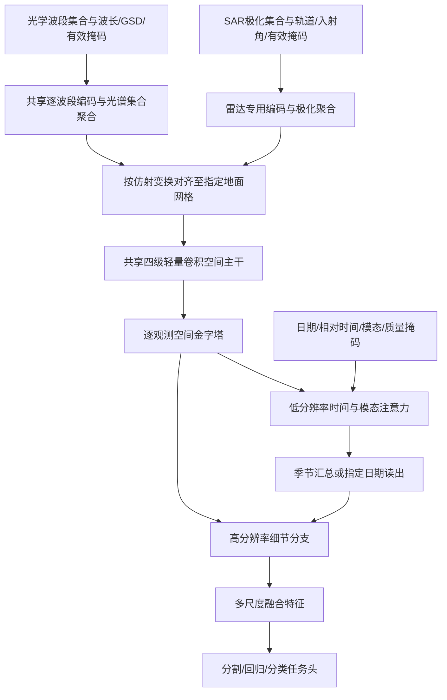

# 自研轻量光学＋SAR Backbone 设计草案

状态：架构与训练设计，尚未实现、测量或验证性能。方案中的规模、batch 和训练超参是候选起点，不是已验证的硬件承诺。

用户已明确：首版 5–15M 参数，主训练环境为单张 RTX 4090 24GB；另有改装 RTX 3080 20GB 环境。首版需要同时支持光学与 SAR，优先多分辨率、多光谱、多时相，普通 RGB 视觉识别不是主要目标。

需求补充：中国地区是主要应用范围，高分辨率光学是重要训练主体。优先采用 GF-2/Five-Billion-Pixels 的 4m 多光谱数据学习空间细节，结合中国区域 S1/S2 学习雷达、更多波段及时间序列。10m 是其中一种输入网格，不是 backbone 的分辨率下限；具体数据路线见 12.9 节。

已有 NAS 数据的候选用途与核查优先级见[NAS 数据筛选建议](./NAS数据用于自研骨干的筛选建议.md)。清单显示还有四/八波段光学和多种 SAR；其数量、地理覆盖、时序完整性及原始文件质量尚未核验，暂不据此扩大数据规模承诺。

执行入口：[NAS 现场核查表](./NAS现场核查表.md)、[自研骨干接入现有评测计划](./自研骨干接入现有评测计划.md)。后者明确了复用 B1/B2/B3 与随机初始化对照，以及 FBP 参与预训练后的 T8 评价边界。

本方案延伸[原自研模型实验方案](./自研多光谱模型实验方案.md)，新增光学＋SAR 输入与可选自监督路线。它不会自动更改现有基准实验协议；所有扩展输入结果必须标明其输入信息差异。

## 1. 推荐方向与借鉴来源

推荐：**波段条件光学入口＋独立 SAR 入口＋共享轻量空间金字塔＋低分辨率时相/模态融合**。工作名称暂用 `GeoFlex-S`，不是已有模型名称或创新性声明。

| 来源 | 借鉴内容 | 在小模型中的取舍 |
| --- | --- | --- |
| Clay / DOFA | 利用波长描述输入，处理不同波段组合；Clay 的 GSD 元数据处理 | 首版用共享逐波段编码＋元数据条件化＋集合聚合，避免直接搬入大型动态权重生成网络 |
| AnySat | 按实际地面尺度组织异构输入；原生处理多时相与多模态 | 借鉴物理尺度和观测集合的组织方式，用卷积金字塔控制空间计算量；不完整复刻其 patch encoder 和 JEPA 系统 |
| Prithvi | 多时相遥感预训练、时间信息、遮挡学习 | 使用日期和相对时间、空间/光谱遮挡目标；首版不使用固定六通道入口或大型时空 ViT |
| U-TAE | 轻量时间注意力与多尺度空间特征结合 | 用于时间融合的对照；主设计保留逐观测特征，支持灾前/灾后读出 |
| CROMA | 雷达与光学分别编码、再融合的训练思路 | 使用小型独立入口和共享空间主干；光学/SAR 对齐损失后加，不把两个模态强行变成相同表示 |

上述组合是待验证的工程假设，不保证继承原模型的成绩，也不支持直接拼接不同模型的预训练权重。项目当前成绩不作为选架构的唯一依据。

## 2. 输入范围与术语

“光学”在本方案中主要指反射型可见光与红外波段：RGB、红边、近红外、短波红外。例如项目中的 GF-2 四波段、S2/HLS 六波段和 S2 十波段。模型应接收实际可用的波段集合，不要求每个样本都有固定数量的波段。

RGB 仍保留且参与训练；优先目标是土地覆盖、作物物候、灾害和生物量等遥感任务。热红外、任意高光谱仪器及全极化/复数 SAR 不属于第一版性能承诺。

SAR 首版优先支持 Sentinel-1 类型的已校准、地理配准实值后向散射输入，例如 VV/VH。波长本身不足以描述 SAR：还需要极化、轨道、入射角、辐射量定义和处理级别。

其他模态及 Prithvi 的实际六波段预训练范围见[遥感模态与 Prithvi 输入范围说明](./遥感模态与Prithvi输入范围说明.md)。SWIR 不等于热红外；DEM/DSM 是高程产品；当前对照的 Prithvi-EO-2.0 300M-TL 不因支持多时相就自动包含 SAR、热红外或高程输入。

## 3. 整体架构



设计中“灵活接收输入”与“对未见输入泛化良好”是不同验收项。前者可以通过接口和小样本测试确认，后者必须用独立传感器、地区、时间和波段组合验证。

## 4. 光学输入模块：可变波段集合

每个波段携带：中心波长、带宽或光谱响应描述、原生 GSD、当前采样网格、处理级别、数值缩放、有效像素掩码。未知元数据使用显式 unknown 标记，不伪造精确值。

建议的轻量实现：

1. 每个波段共用一个小型局部编码器，输出约 16–24 维特征；同 GSD 的波段可批处理。
2. 用元数据 MLP 对特征进行条件化，例如 FiLM 的缩放和偏置。
3. 按真实仿射变换将特征与有效掩码映射到该样本的共享特征网格。
4. 在每个空间位置，用 4 个可学习光谱查询聚合有效波段；拼接后投影为 64 通道。避免过早把所有波段压成一个标量或单个均值。

概念形式：

`e_b(x,y) = FiLM(shared_band_stem(X_b), metadata_b)`

`z_k(x,y) = sum_b masked_softmax_b(q_k · key(e_b)) · value(e_b)`

没有有效波段的位置返回显式无效标记；不能对全部被 mask 的集合直接 softmax。交换波段和对应元数据的顺序，结果应保持一致。缺失波段通过 mask/集合长度表达，padding 的零不作为真实观测参与计算。

第一版优先这个可解释、可单测的入口；将其与“固定六波段卷积入口”和“Clay/DOFA 风格波长动态卷积入口”做容量可比的消融。仅有中心波长不意味着不同传感器已自动完成辐射一致化。

## 5. SAR 输入模块：独立物理语义

使用小型共享逐极化编码器与极化标识聚合，输出同为 64 通道。首版支持 VV、VH 及缺失一种极化的情况，只有训练过且验证通过的组合才能宣布支持。

- 记录输入是 sigma0/gamma0、线性功率还是 dB，避免对 dB 再取对数。
- 从训练数据统计归一化参数；保留绝对后向散射信息，避免逐景标准化抹掉有用的幅度差异。
- VV/VH 比值若使用，明确在线性功率域计算；dB 差值与比值的对应关系须在预处理中固定。
- 极化、升/降轨、入射角、传感器/处理级别通过条件向量进入入口。
- 对斑点噪声使用合理的空间建模和增强；首轮不以逐像素精确重建斑点为主要目标。

光学与 SAR 在入口后共享空间主干，但保留模态条件化的小参数和各自的有效掩码。共享是否导致负迁移，需要与独立浅层编码器对照。

## 6. 多分辨率：显式地面网格与保留细节

必须区分输入像素数、GSD、实际地面范围、波段原生分辨率和输出标签网格。相同 256×256 输入在 2m 和 30m GSD 下代表不同地面范围。

每个样本指定参考输出网格 `g0` 及其 affine/CRS；首个共享特征网格目标为约 `4*g0` 米/格。不同观测以相同物理区域为基础对齐，不用 resize 将不同地面范围伪装成相同区域。

- 逐波段局部编码可在原生网格上执行，然后对齐特征。粗波段不能被解释成拥有细网格上的真实细节。
- 下采样应抗混叠；无效像素参与插值前需妥善处理，不能让 nodata 污染邻域。
- 给模型同时提供原生分辨率与当前网格尺度，明确上采样/降采样历史。
- 共享空间阶段用 `log(GSD)`/有效特征尺度等条件化；尺度感知与多 GSD 训练一起使用，不能宣称仅增加 GSD 编码就获得尺度不变性。
- GF 类高分辨率任务使用相应的细网格与细节分支，不强制压到 30m。S1/S2 和 HLS 任务可以采用不同 `g0`，但同一严格对比表中输出与监督规则一致。
- 图像和日期间的配准误差需独立检查。首版假定已有可用地理配准，不承诺由网络解决任意偏移。

实现上先做“一个样本内的观测已对齐至明确参考网格”的稳定版本，再添加原生多网格特征对齐。两者均可支持不同样本具有不同 GSD，但原生多网格能力需要单独验收。

## 7. 空间主干与参数预算

主干采用窄版 ConvNeXt 风格块：depthwise 空间卷积＋逐点 MLP＋归一化＋残差。首版空间 MLP expansion=4；不依赖 ImageNet RGB 预训练。

| 阶段 | 相对参考图像步长 | 通道 | 块数 |
| --- | ---: | ---: | ---: |
| Stage 1 | 4 | 64 | 2 |
| Stage 2 | 8 | 128 | 2 |
| Stage 3 | 16 | 256 | 6 |
| Stage 4 | 32 | 384 | 2 |

空间主干跨日期和模态共享参数。共享参数不会让计算量与观测数无关：更多观测仍增加前向/反向和激活。

在 Stage 3、Stage 4 分别增加 2 层沿观测维度的注意力，FFN expansion=2，头数=4。按标准线性层、卷积和偏置的近似计算，空间块约 6.0M、阶段降采样约 0.56M、两级时间注意力约 3.43M，三者合计约 9.98M。入口、条件化及读出加入后，**backbone 设计目标约 10–12M**。

这只是按结构估算，最终以实现的参数统计为准。任务头和自监督 decoder 另报，不能隐入 backbone 参数量。若希望更轻，可将宽度缩为 `[48,96,192,256]` 并实测，其目标为约 5–7M 档。

## 8. 多时相与模态融合

一个 token 对应某地面位置上的一次有效观测，携带实际日期、相对目标日期的时间差、模态和质量信息。允许光学与 SAR 日期不同，不伪造同时观测。

时间信息同时包含年内周期与相对时间：DOY 的 sin/cos 表达季节，相对天数区分跨年和事件前后。没有日期时使用 unknown 标志。首版默认不依赖绝对经纬度，以便观察真实视觉迁移；位置编码作为独立消融。

- 只在 1/16、1/32 的空间网格上执行观测间注意力；避免在全部波段、时相和像素上做联合全局注意力。
- 支持 observation mask 和像素级云/nodata mask，训练时模拟缺日期和缺模态。
- 模型保留更新后的逐观测特征，再通过查询读出汇总结果。
- 季节性作物任务可使用季节汇总查询；洪水/烧毁任务使用指定日期查询；变化任务读出两个目标日期及其差异。不要在入口就将整个时间序列不可逆地均值池化。
- 高分辨率跳接可通过粗尺度查询权重上采样后加权聚合，同时保留目标日期细节；注意力权重需与有效掩码共同使用。
- 重复观测、采样频率和同一天的多传感器不能被当作独立地面样本。采样时限制过密序列，记录实际时间间隔。

建议数据接口按观测列表组织；实现可用 padding、bucket 和 mask 批处理：

```text
sample:
  reference_grid: {crs, affine, height, width, gsd_m}
  observations:
    - modality: optical | sar
      pixels: [C,H,W]
      timestamp: actual timestamp | unknown
      channels: per-channel metadata
      valid_mask: [C,H,W] or explicitly broadcastable mask
      acquisition_metadata: sensor / processing / orbit / incidence
  target_time: optional
```

输出应同时提供逐观测与融合特征、空间步长、目标网格和有效掩码，便于统一时间头对照和原生融合对照。

## 9. 训练路线

### 阶段 A：用已有标注数据验证结构

先做单模态和简单时间融合，再逐步启用复杂模块。候选任务为 T1 光学/SAR、T2 光学烧毁、T5 光学时序、T8 高分辨率土地覆盖；以实际数据可用情况为准。

T1 与 T1S 若来自同一景，必须共享划分，不能当作新增独立样本。光学＋SAR 联合训练需要核对样本配对、日期和地理对齐；分别存在两个数据集不等于已经拥有可靠配对。

多任务使用共享 backbone 与独立任务头，按任务平衡采样，并将损失按有效像素/样本合理归一化。联合训练需要在全部任务的验证/测试区域并集上做排除，避免一个任务的训练集包含另一个任务的测试区域。

全量训练 backbone；损失在完整标签网格计算。优化器可从 AdamW、LR `3e-4`、warmup＋cosine 起步，验证搜索候选为 `1e-4/3e-4/1e-3`，这些是起点而非最优配置结论。batch 使用梯度累积对齐有效样本数。

这一阶段回答结构能否学习、输入是否有效、融合是否有收益，不能凭几个小标注集宣布获得通用遥感预训练能力。

### 阶段 B：多传感器自监督预训练

使用地域和季节更丰富的未标注数据，保留单模态观测和可用的配对观测。先做掩码学习，再按证据增加跨模态一致性；预训练数据覆盖和与下游数据重叠情况需记录。

首轮目标：

- 光学：有效反射率的遮挡区域重建与部分波段重建，按波段归一化损失，避免 RGB 因数值或样本量占主导。
- SAR：在确定的数值域上做鲁棒重建，可预测局部聚合目标；避免把精确重建斑点噪声当作主要能力。
- 时相：保留真实日期，并在足够上下文下预测被遮挡观测；对有实际标签的变化任务保留监督信号。
- 模态：随机移除光学或 SAR，训练单模态与联合使用路径；不移除所有有效输入。

输入屏蔽必须发生在任何可能泄漏目标的空间卷积之前。纯空间重建实验可对所有波段/观测使用同区域屏蔽；跨波段或跨模态重建是另一类明确标记的目标，不能将其简单重建成绩解释成空间理解能力。训练用 decoder 不参与下游 backbone 参数统计。

跨模态对齐只作用于配准且时间条件合适的共同语义部分，保留模态专有特征；不能强迫灾前灾后或跨季节影像表示完全相同。小 batch 对比学习的负样本也需避免相邻地块和同地点观测造成错误负样本。

首版不同时引入多个大型教师。若后续使用 AnySat/Clay/Prithvi 蒸馏，应单教师逐一消融，限定输入适配与特征对齐，并报告教师推理/缓存成本。

### 阶段 C：冻结、微调与未见输入评价

按项目四维建议，评估同预算冻结/微调、少标注、地理 holdout、输入缺失和成本。模型选择只看验证集，独立测试配置预先锁定。

## 10. 4090 24GB 与改装 3080 20GB 的规模判断

“显存能装下”“训练效率合理”“有足够数据训练好”是三个不同条件。以下为工程规划范围，不是已测上限；多时相分割应比单图分类更保守。

| 参数档位 | 对本项目的判断 |
| --- | --- |
| 5–15M | 推荐首版；方便比较输入与融合机制，仍需控制序列和分辨率 |
| 20–50M | 可作为扩容候选，先实测单步峰值和吞吐 |
| 50–100M | 需要更仔细控制 micro-batch、输入网格与序列长度，自监督反复试验成本明显增加 |
| 100–300M | 某些裁剪、序列和混合精度设置下可能全量训练；不能据参数数目保证当前多模态配置能运行 |
| 300M 以上 | 不作为这套设备下从零预训练的首选；冻结/参数高效适配与全量训练应分别判断 |

常规 FP32 参数、FP32 梯度、AdamW 两份 FP32 动量状态的持久内存约为 `16 × 参数数` 字节：

| 参数量 | 参数＋梯度＋AdamW 状态估算（十进制 GB） |
| ---: | ---: |
| 15M | 0.24 |
| 50M | 0.80 |
| 100M | 1.60 |
| 300M | 4.80 |
| 1B | 16.00 |

以上不包括激活、临时工作空间、缓存、额外精度副本、教师模型、任务头与数据。实现和精度策略改变时需要重算。autocast 不会自动将所有 optimizer 状态减半。

256→512 的像素数增加为 4 倍，卷积激活通常随空间面积增长；普通显式全局注意力的分数矩阵会随 token 数平方增长。高效注意力能降低分数矩阵存储，但不能消除全部激活与计算开销。增加日期和模态通常继续增加激活；本设计在低分辨率沿观测维度融合以控制此成本。

**起步 profile 配置：** 256×256 参考网格，光学 4 次＋SAR 4 次观测以内，micro-batch=1，从小规模向上增大。4090 优先检查 BF16 支持并启用 autocast；3080 的实际精度支持与稳定性在该环境验证，必要时用 FP16＋GradScaler。有效 batch 可通过累积逐步达到 8–16，但累积不会降低单个样本的峰值显存，也不改变 micro-batch 归一化行为。

先测包含 optimizer 第一次更新的 50–100 个训练 step，记录峰值 allocated/reserved、吞吐和数据等待，再决定 crop、日期数和 micro-batch。需要时对空间阶段使用 activation checkpointing，以额外计算换显存。

4090 作为主训练设备；3080 优先承担小模型、单模态消融或评估。两卡若处在不同环境，分别运行独立实验最直接；普通 DDP 即使在同一主机也不会把两张卡显存直接合成 44GB，且快卡会等待慢卡。模型分片是另一套复杂度，不作为首版默认方案。

训练时长应实测估算：`训练 steps × 稳态秒/step + 验证 + 预处理/缓存`。在数据规模、CPU/I/O、实现和输入规格未知时，不给出“几天完成通用预训练”的承诺。

## 11. 必要消融与验收

按依赖顺序开展，先单 seed 验证，锁定方案后跑正式重复：

1. 固定波段入口 vs 波长条件集合入口：相同任务、输入信息和近似容量。
2. 光学单独、SAR 单独、联合输入、测试时缺一个模态：衡量增益与降级行为。
3. 不用尺度元数据 vs 使用尺度元数据；分别测试已见 GSD、新 GSD、真实新传感器，合成降采样单列。
4. 单时相、masked mean、轻量时间注意力、保留日期查询的融合：评估物候与事件任务。
5. 同架构随机初始化 vs 自监督预训练：报告 10%/30%/100% 标注曲线。
6. 约 5–7M vs 10–12M 两档：固定数据与搜索预算，观察扩容是否值得。

功能验收包括：波段及其元数据共同换序后结果一致；padding 不参与计算；全无效位置不产生 NaN；单时相/单模态退化路径有效；日期与观测一起换序后结果一致，但改变实际日期可影响结果；mask、输入缩放与地理对齐正确；所有应训练模块有有效梯度和参数更新。

对跨模态融合，验收重点是任务效果和单模态退化能力，不把光学/SAR 特征完全相同作为成功标准。对注意力可视化，不直接将权重大小解释为因果贡献，需通过输入消融验证。

## 12. 训练数据规模与规格

以下规模是针对约 10–12M backbone、单张 4090 的分阶段工程建议，不是模型性能的理论下限或收敛保证。数据多样性、任务难度、训练步数和质量比单纯 patch 数更重要。

### 12.1 统计单位与规模建议

统一使用三个统计量：独立地理位置数、每个位置的实际日期数、每个日期的传感器观测数。对齐的一份光学影像与一份 SAR 影像称一组配对观测，但必须分别保存两者的真实日期。由同一影像裁出的高度重叠 patch 不能直接计作新的独立地点。

| 阶段 | 地理位置数量级 | 每位置日期数 | 用途 |
| --- | ---: | ---: | --- |
| 流程与数值调试 | 500–2,000 | 1–4 | 验证单位、配准、梯度、mask、单/双模态路径及吞吐，不用于通用能力结论 |
| 架构验证与预训练试跑 | 5,000–20,000 | 4–8 | 约 2–16 万组配对观测的候选规模；比较输入模块、时间融合和小规模自监督是否有效 |
| 首版正式预训练 | 30,000–100,000 | 4–8 | 约 12–80 万组配对观测的候选规模；按地理和季节分层取样，并加入真实异构传感器 |
| 后续扩展 | 100,000–250,000 或更多 | 4–12 | 在前一阶段学习曲线和迁移实验支持扩容时进行；不作为第一步必需条件 |

**多时相光学/SAR 数据池的候选起点：先准备 5,000 个位置；架构稳定后视学习曲线扩到约 50,000 个位置，每位置 4–8 个日期。** 后者对应约 20–40 万组配对观测，不要求单次训练将所有日期同时装入显存。中国高分辨率路线还包含独立的 GF-2 单时相训练池，不要求先凑齐这 5 万个多时相地点才能开始，见 12.9 节。

训练时先抽取每位置 1–4 个光学日期、1–4 个 SAR 日期，之后再增加长序列。另选约 2,000–5,000 个位置保留 12–24 期较密集序列，用于缺日期、物候和不规则采样实验；四个季节样本不能充分代表密集时序能力。该子集的规模是建议，不保证现有公开数据中有对应数量的独立区域。

### 12.2 空间、通道、时间和数值规格

| 项目 | 首版建议 |
| --- | --- |
| 训练裁块 | 以 256×256 参考网格起步；高分辨率细节后续加入 384/512 裁块消融，先测显存 |
| 光学范围 | 中国高分辨率主体优先保留 GF-2 的实际四波段；S2 保存 10 个任务相关反射波段，训练时抽取真实可用子集；HLS 保存实际六波段 |
| S2 十波段示例 | B2、B3、B4、B5、B6、B7、B8、B8A、B11、B12；保留各波段原生 GSD 与处理信息 |
| SAR 范围 | 首版 VV/VH 实值已校准后向散射；完整记录轨道、处理级别和数值域；入射角尽量提供 |
| 时间 | 保存真实 UTC 日期/时间、观测间隔、有效观测 mask；不将 SAR 配对日期改写成光学日期 |
| 光学辐射量 | 优先以地表反射率建立主要训练域；L1C/TOA 单独标记，避免与地表反射率无标识混用 |
| 数值存储 | 优先保存原始定标整数或可靠浮点数据及 scale/offset；不把科学数据统一转换成 RGB/JPEG 或逐景 8-bit 拉伸 |
| 空间信息 | CRS、affine、footprint、GSD、原始 scene/region ID、当前重采样网格 |
| 质量信息 | 光学云/阴影/雪及 nodata；SAR 有效范围与可用的几何质量标记；区分“缺失”“受云污染”“数值为零” |
| 标签 | 自监督主体无需人工标签；保留独立下游标签集用于迁移验证 |

同一 256×256 裁块在 10m GSD 下约覆盖 2.56km×2.56km，在 30m 下约覆盖 7.68km×7.68km。S2 与 HLS 若要配对同一区域，必须使用一致 footprint，而不能仅各裁 256×256 就认为配准完成。一个约 2.56km 宽的区域在 30m 网格只有约 85 个像素，边界按实际 affine 与覆盖规则确定。

尽量保留原始高位深数据。为了节省空间转成 float16 或定标 int16 时，应检查范围、量化误差及对派生指数的影响；不能把负值 dB 数据直接强转为 uint16。归一化参数从训练部分计算或使用明确适用的传感器标定，验证/测试不参与统计。

### 12.3 数据分布比重复裁块更重要

建议覆盖农田、森林、草地、水体/湿地、城镇、裸地、山地，并纳入不同气候区、地形、季节和云量。按数据可用情况设采样分层，不要求所有类别平均到不符合现实分布。

针对中国高分辨率需求，一个可调整的训练批次采样起点是：约 60% GF-2 高分辨率光学，40% 中国区域 S1/S2 多时相观测。先不强制加入 HLS，后续有明确 30m 需求再添加。这里是批次采样权重，不代表数据量或算力占比；不能把同地点的不同产品计算为全新独立地点。高分辨率光学缺少匹配 SAR 时允许使用光学单模态路径。

这个比例需要通过目标任务验证调整。仅使用 S2 的人工降采样可以训练尺度鲁棒性，但不能据此宣布支持真实 GF/HLS 等传感器。首版若缺乏高分辨率样本，应收窄性能声明，而不是依靠 GSD 编码补足未观察到的传感器分布。

对作物物候，额外覆盖关键生育阶段和不规则间隔；对洪水、火灾等快速变化，保留事件前后序列。不能要求所有日期拥有相同地物状态，也不能把跨事件差异当作噪声抹除。

### 12.4 配对与质量控制

光学/SAR 共同学习需要至少一部分可靠的同地区配对数据，单模态数据也可以参与训练。配对按 footprint 和真实时间距离建立，并记录质量与时间差。

- 静态土地覆盖可考虑数日内邻近观测，候选起点为 3–7 天，但必须根据地表变化核查；这不是通用安全阈值。
- 洪水或火灾等快速事件需要更严格时间匹配，优先同一天或经事件时间线核实的观测；不能直接沿用季节性任务的时间窗口。
- 对配准进行边缘叠加、抽样可视化和质量统计，不只检查 CRS 相同。
- 训练主体可优先选有效面积较高的观测，同时保留一部分有云/缺失样本学习降级能力。自监督目标只对可信目标像素计算，不能把云下未知反射率当作真实地表值。
- 对重复影像、重叠 footprint、相同原始 scene、时间重复和损坏文件做审计；采用地理块/区域分组，而不是仅靠文件名去重。

### 12.5 公开数据起点

**多模态补充数据可考察 SSL4EO-S12 v1.1 的 S2L2A＋S1GRD 子集。** 官方说明包含 246,144 个位置、每位置四期观测，并提供按模态选取与 WebDataset 读取方式。完整版本含更多模态，官方给出的总存储需求为约 2.3TB；本项目不需要为首轮实验下载全部模态。该数据适合四季多模态预训练起点，但四期观测不足以单独验证密集物候过程。中国范围需依据坐标筛选并统计覆盖，不能假定全球数据量等于中国可用数据量。[官方数据与读取说明](https://github.com/DLR-MF-DAS/SSL4EO-S12-v1.1)

原 SSL4EO-S12 的官方说明为 251,079 个位置与四季观测。两个版本应明确版本号与样本清单，不混用统计数量。原版页面还说明了 8-bit/JPEG 压缩版本与原始数值版本的区别，因此首版科学输入建议优先选择保留原始数值的资源。[原版官方说明](https://github.com/zhu-xlab/SSL4EO-S12)

**长时序可考察 SEN12MS-CR-TS。** 官方资料提供全年光学/SAR 序列；需重新审计区域重叠、云掩码、真实采集日期和配对时间差。其云去除用途与本项目通用表征目标不同，不能直接把云去除训练划分或匹配窗口当作灾害识别的适用协议。[官方仓库](https://github.com/PatrickTUM/SEN12MS-CR-TS)

HLS 与高分辨率光学用于补足真实跨分辨率/跨传感器训练。现有下游 benchmark 数据可以做监督架构验证；若将其训练部分纳入自监督，要明确声明，并排除验证/测试地区，保持独立泛化评价。

### 12.6 标注数据与验证集

自监督预训练主体不要求逐像素人工标签。下游小数据用于检验迁移价值，第一轮可复用现有 T1/T2/T5/T8 的官方或项目锁定划分，不设“所有任务必须达到相同样本数”的门槛。

如果自行建设新的标注集，建议从每任务几百到几千个有代表性的标注 patch 开始，重点检查类别覆盖、稀有事件、标注一致性和地理独立性。几千个来自一个区域的重叠 patch，不能替代多个独立地区的验证证据；具体需要多少取决于学习曲线与置信区间。

预训练开发集与下游验证/测试应独立管理。自建数据可先按地理组约 90%/5%/5% 划分用于训练、开发和保留审计，最终比例随独立区域数确定。官方已有划分则保留。所有同地点日期、传感器及派生产品必须在同一组；应排查预训练地点与下游保留区域的重叠，重叠不可避免时如实报告，不称严格地域外推。

### 12.7 存储估算与 I/O

以下仅估算对齐至 256×256 网格的影像数值体积，假设每个值使用 2 字节；不等于公开数据包的下载大小。实际 SAR float32、原生不同网格、压缩、mask 和保留原始副本都会改变总量。

| 配对日期组数 | 6 光学＋2 SAR，2字节/值 | 10 光学＋2 SAR，2字节/值 |
| ---: | ---: | ---: |
| 200,000 | 约 0.21 TB | 约 0.315 TB |
| 400,000 | 约 0.42 TB | 约 0.629 TB |
| 800,000 | 约 0.84 TB | 约 1.258 TB |

公式：`组数 × H × W × 通道总数 × 每值字节数`。全部使用 float32 时，表内数值约加倍。这里 TB 为十进制，且只计一份影像；512×512 时面积为四倍。

针对推荐的 50,000 个位置、4–8 期、10光学＋2SAR，单份处理后数值数据约 0.315–0.629TB。若同时保留原始副本、掩码、解压缓存和 checkpoint，建议规划约 **1–2TB 可用数据空间**，具体以抽样实测为准；不建议在未选定数据版本前按此估算采购或下载全集。开发子集可以明显更小。

建议原始数据使用可追溯 GeoTIFF/COG，训练视图按地理组写入大小适中的 shard（例如 WebDataset）或合理分块数组。避免每个波段、日期和裁块各产生大量小文件。保存可逆 scale/offset 与元数据索引，抽样验证 shard 解码与原数据数值一致。CPU、磁盘吞吐和预取同样会影响 4090 利用率；先观察 GPU 数据等待再优化。

### 12.8 数据量与训练时间的关系

一个训练样本是一个位置抽出的观测集合，不能把 40 万幅图像直接当成 40 万条完整序列。假设每轮访问 50,000 个位置、有效 batch=8，则一轮约 6,250 次 optimizer update；20 轮约 125,000 次 update。每个 update 若累积 8 个 micro-batch，耗时必须包括全部 8 次前向/反向。

先用 5,000 个位置运行短试验，测完整 update 的耗时与验证迁移曲线，再决定正式数据池和训练预算。数据下载量、每轮抽样数量、每位置抽取的日期数可以分别控制。能保存几十万组观测，不意味着首版需要先跑完几百个 epoch。

### 12.9 中国地区优先：GF-2/GID/Five-Billion-Pixels 路线

**推荐将 Five-Billion-Pixels 作为高分辨率监督学习的主要数据之一，同时保留中国区域 S1/S2 时序训练池。** 对地块边界、城镇肌理和较小目标，10m 输入可能丢失关键细节；对区域覆盖、季节变化和光谱判别，S2 仍有补充价值。数据的原生分辨率、当前网格与目标输出尺度分别记录，不把所有输入统一降成 10m。

#### 数据集选择与边界

| 数据 | 官方信息与用途 | 本方案使用方式 |
| --- | --- | --- |
| GID | 大规模部分含 150 幅像素标注 GF-2 影像；细分类部分含 30,000 个多尺度 patch 和 10 幅像素标注影像 | 可用于较粗类别监督或与已有项目基准对接；先检查具体下载版本、通道及划分 |
| Five-Billion-Pixels（FBP） | 150 幅 4m GF-2 影像、24 类、覆盖中国超过 50,000 平方公里；扩展自 GID/GID-15 | 优先作为细分类高分辨率训练主体；保留未标注区域的 ignore mask |

来源：[GID 官方页](https://captain-whu.github.io/GID/)、[FBP 官方页](https://x-ytong.github.io/project/Five-Billion-Pixels.html)。两者有数据继承关系，必须依据 scene ID、坐标、影像内容核对重叠；不能将 GID 全部用于训练，再以 FBP 成绩宣称独立泛化，也不能把两者简单相加为 300 幅独立影像。

FBP 论文明确使用蓝、绿、红、近红外四波段，影像尺寸为 6800×7200；GF-2 传感器的 1m 全色和 4m 多光谱是不同产品。不能因为卫星拥有 1m 全色能力，就把当前 FBP 四波段数据称为 1m 数据。[论文中的数据说明](https://doi.org/10.1016/j.isprsjprs.2022.12.011)

优先检查 16-bit 发布包的实际波段顺序、数值范围、nodata、坐标及处理级别。高位深不自动等于地表反射率；若是 DN 或其他处理结果，显式标记并使用适合该域的归一化。官网也提供 8-bit 数据读取提示，这类派生产品的处理历史需要独立记录，不能与原始科学数值无标识混用。

#### 两个训练池，不强求所有样本同时具备全部模态

1. **GF-2 空间细节池：**使用锁定训练划分中的 FBP 四波段影像与 24 类标签，训练高分辨率分割和可选的掩码预训练。普通 RGB 分类不是优先目标，并不意味着遥感中的 RGB 空间纹理不重要；RGB＋NIR 正好是这里的有效输入。
2. **中国 S1/S2 时序池：**先准备约 5,000 个位置、4–8 期真实观测，覆盖不同农业区、城镇、山地和气候条件。优先核实可用数据，之后按学习曲线扩展；补足 GF-2 四波段缺少的红边/SWIR、SAR 及同地点多日期能力。
3. 两池交替训练，共享 backbone，使用对应的监督/自监督目标；GF-2 单时相样本不创建假日期或假 SAR。候选批次比例 60:40，并记录各池更新数、有效像素、计算时间和损失尺度，比较 50:50 或 70:30 时固定总预算。
4. 若后续取得同地点、时间可核实的 GF-2/S1/S2，另建配对融合子集。先核查 GF-2 的采集时间、定位精度和对应历史影像可用性；只有坐标或同年影像不等于事件级同步观测。首版可支持两类输入路径，但不能仅凭分开训练就宣称已验证 GF-2＋SAR 联合输入增益。

GF-2 池可先从训练区域抽取 5,000–20,000 个候选裁块验证架构，再动态采样扩大覆盖。这里是裁块数，不是独立城市或独立场景数；不必先拥有数万幅 GF-2 大图。按场景、类别及地貌分层采样，抑制大量相邻重复裁块，不靠密集重叠夸大训练规模。

#### 分辨率、结构与单卡预算调整

- GF-2 以原生 4m 输入，先训练 256×256（约 1.024km 宽），再测试 512×512（约 2.048km 宽）；S1/S2 时序保持较粗的合适网格。高分辨率单时相与较低分辨率多时相使用不同 batch bucket。
- 相同像素尺寸下，GSD 从 10m 改成 4m 不直接增加网络计算量，但地面视野变小；若保持相同地面范围，像素面积约增至 6.25 倍，激活与计算会明显增长。不能将 4m 输入简单等同于需要更大参数模型。
- 原设计的 stride-4 空间主干在 4m 输入下首级特征间距约 16m。增加一个轻量 stride-1/2 细节旁路，与金字塔解码器融合，检查边界、小地块和细长目标的保留情况。旁路新增参数与显存需重新统计；原约 10–12M 是未含此修订实测的设计估计。
- 主干仍以卷积金字塔和低分辨率时相注意力为主，不在所有高分辨率像素上做全时空注意力。若融合配对 S1/S2，在共同物理范围的粗特征层融合，保留 GF-2 细节旁路；把 SAR 上采样到 4m 不代表获得 4m 雷达细节。
- 输入/输出 4m 不保证足以精细描绘单栋建筑或窄路。若这类目标是最终核心，应另补真实更高分辨率数据，并独立处理全色融合产品的辐射与空间特性。

#### 划分与验收优先级

先按原始大图、重叠 footprint 与地理区域联合分组，再裁 patch。不得随机混分同一大图中的相邻 patch。与官方基准比较时保留其协议；额外设独立地区留出测试，并披露两种协议的差别。若 FBP 已用于预训练或监督训练，GID 上重叠区域即使换标签也不是独立测试。

第一轮至少分别报告：GF-2 的 mIoU/各类 IoU 与边界指标；中国 S1/S2 的时序任务表现；光学单独/SAR 单独及缺模态表现；不同区域泛化。边界指标的容差需注明像素与实际米数。比较 GF-2-only、S1/S2-only 与混合训练，确认混合没有明显损害主要高分辨率任务；用同地区、同输入的既有模型作为公平对照。

当前只核对了官方页面和论文；未下载数据包，尚未验证实际文件、完整元数据、场景重叠及中国子集数量。这些决定最终可执行清单。

## 13. 一手参考资料

- [AnySat 论文](https://arxiv.org/html/2412.14123v3)：尺度自适应编码、多模态与轻量时间编码，以及 JEPA 训练框架。
- [Clay 编码器源码](https://github.com/Clay-foundation/model/blob/main/claymodel/model.py)与[动态嵌入源码](https://github.com/Clay-foundation/model/blob/main/claymodel/factory.py)：波长条件输入和 GSD 元数据。
- [DOFA 论文](https://arxiv.org/abs/2403.15356)：波长条件动态网络的架构参考。
- [Prithvi-EO-2.0 论文](https://arxiv.org/abs/2412.02732)：多时相预训练及时间/位置嵌入。
- [U-TAE 官方实现](https://github.com/VSainteuf/utae-paps)：轻量时序空间编码的参考与对照。
- [CROMA 官方实现](https://github.com/antofuller/CROMA)：光学/SAR 分支与融合训练的参考。
- [ConvNeXt 论文](https://openaccess.thecvf.com/content/CVPR2022/html/Liu_A_ConvNet_for_the_2020s_CVPR_2022_paper.html)：空间块参考，不意味着照搬其模型规模或 RGB 训练目标。
- [PyTorch 混合精度示例](https://docs.pytorch.org/docs/stable/notes/amp_examples.html)与[activation checkpointing](https://docs.pytorch.org/docs/stable/checkpoint.html)：显存规划与实现参考。
